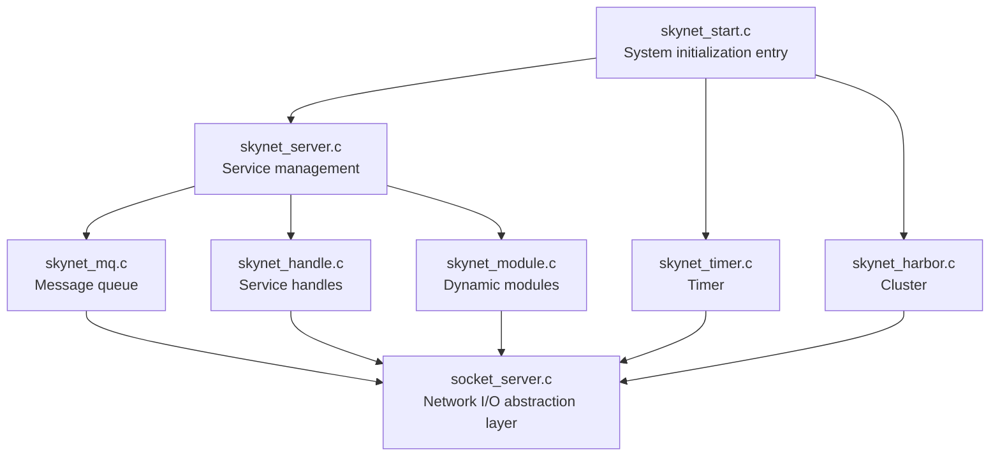
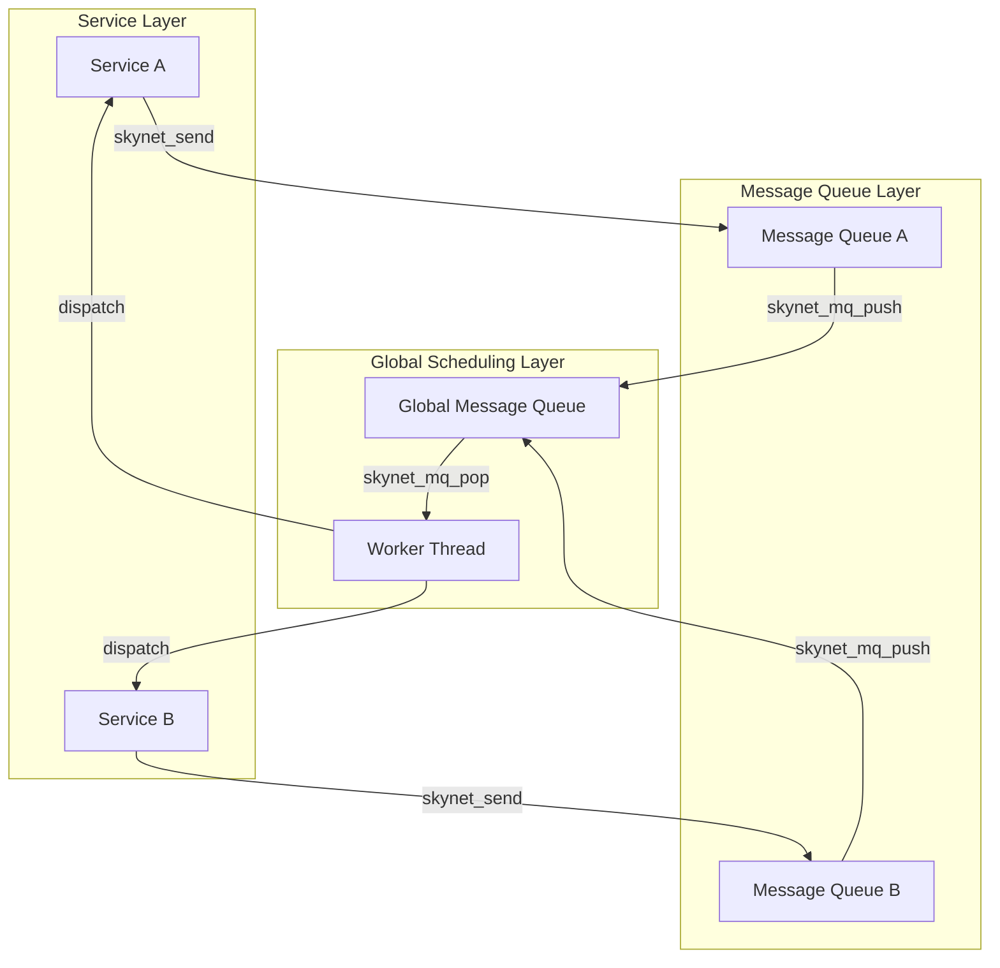
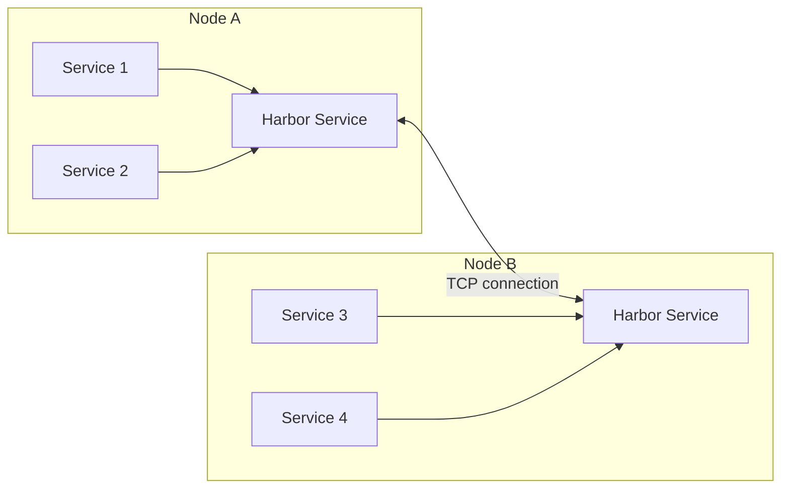

# Core Modules Overview

The core of Skynet is implemented in C. While reading the source code, we organized the responsibilities and dependencies of each module to make the overall architecture easier to understand.

## Module Dependencies



## Core Module List

### 1. skynet_start.c - System Startup

**Responsibility**: initialize the entire Skynet system

**Key functions**:
- `skynet_start()`: system entry point
- `start_thread()`: create worker threads
- `thread_worker()`: worker thread main loop

**Startup flow**:
1. Parse the configuration
2. Initialize each subsystem
3. Create worker threads
4. Load the bootstrap service
5. Enter the main loop

### 2. skynet_server.c - Service Management

**Responsibility**: service creation, destruction, and message handling

**Core data structures**:
```c
struct skynet_context {
    void *instance;           // service instance
    struct skynet_module *mod; // module pointer
    void *cb_ud;              // callback user data
    skynet_cb cb;             // message callback function
    struct message_queue *queue; // message queue
    char result[32];          // result buffer
    uint32_t handle;          // service handle
    int session_id;           // session ID
    int ref;                  // reference count
    char *name;               // service name
};
```

**Key functions**:
- `skynet_context_new()`: create a new service
- `skynet_context_grab()`: increment the reference count
- `skynet_context_release()`: decrement the reference count
- `skynet_send()`: send a message
- `skynet_callback()`: set the callback function

### 3. skynet_mq.c - Message Queue

**Responsibility**: manage the message queues of services

**Core data structures**:
```c
struct message_queue {
    struct spinlock lock;     // spinlock
    uint32_t handle;          // handle of the owning service
    int cap;                  // queue capacity
    int head;                 // queue head
    int tail;                 // queue tail
    int in_global;           // whether it is in the global queue
    struct skynet_message *queue; // message array
};
```

**Key functions**:
- `skynet_mq_create()`: create a message queue
- `skynet_mq_push()`: enqueue a message
- `skynet_mq_pop()`: dequeue a message
- `skynet_mq_mark_release()`: mark the queue for release

**Global queue**:
```c
struct global_queue {
    struct message_queue *head; // head of the queue linked list
    struct message_queue *tail; // tail of the queue linked list
    struct spinlock lock;       // spinlock
};
```

### 4. skynet_handle.c - Service Handles

**Responsibility**: manage the mapping of service handles

**Core data structures**:
```c
struct handle_storage {
    struct rwlock lock;        // read-write lock
    uint32_t harbor;          // Harbor ID
    int slot_size;            // slot size
    struct skynet_context **slot; // service array
};
```

**Key functions**:
- `skynet_handle_register()`: register a service
- `skynet_handle_retire()`: retire a service
- `skynet_handle_grab()`: grab a service
- `skynet_handle_findname()`: look up a service by name

### 5. skynet_module.c - Dynamic Modules

**Responsibility**: load and manage C service modules

**Module interface**:
```c
struct skynet_module {
    const char *name;         // module name
    void *module;             // dynamic library handle
    void (*init)(const char *args); // initialization function
    void (*release)(void *inst);     // release function
    void (*signal)(void *inst, int signal); // signal handling
};
```

**Key functions**:
- `skynet_module_create()`: create a module instance
- `skynet_module_instance_release()`: release a module instance
- `skynet_module_query()`: query a module

### 6. skynet_timer.c - Timer

**Responsibility**: provide timer functionality

**Core data structures**:
```c
struct timer {
    struct link_list near[4][64]; // near-term timers (timing wheel)
    struct link_list far[4][64];  // far-term timers
    struct spinlock lock;         // spinlock
    uint32_t time;               // current time
    uint32_t starttime;          // start time
    uint64_t current;            // current timestamp
    uint64_t current_point;      // current time point
};
```

**Key functions**:
- `skynet_timer_init()`: initialize the timer
- `skynet_timer_timeout()`: set a timeout
- `skynet_timer_update()`: update the timer

### 7. socket_server.c - Network I/O

**Responsibility**: provide a unified network I/O abstraction

**Core data structures**:
```c
struct socket {
    int fd;                    // file descriptor
    int id;                    // socket ID
    int type;                  // socket type
    int size;                  // buffer size
    struct wb_list high;       // high-priority write buffer
    struct wb_list low;        // low-priority write buffer
    int stat;                  // status
    int64_t wb_size;           // write buffer size
    uint32_t watching;         // monitoring flags
    void *p;                   // user data
};
```

**Key functions**:
- `socket_server_create()`: create the socket server
- `socket_server_listen()`: listen for connections
- `socket_server_send()`: send data
- `socket_server_poll()`: poll for events

### 8. skynet_harbor.c - Cluster

**Responsibility**: support cross-node service calls

**Key functions**:
- `skynet_harbor_start()`: start Harbor
- `skynet_harbor_send()`: send a cross-node message
- `skynet_harbor_register()`: register a global service

### 9. skynet_daemon.c - Daemon

**Responsibility**: run Skynet as a daemon

**Key functions**:
- `daemon_init()`: initialize the daemon
- `daemon_exit()`: exit the daemon

### 10. skynet_log.c - Logging

**Responsibility**: log recording

**Key functions**:
- `skynet_error()`: log an error message
- `skynet_log_init()`: initialize the logging system

## Inter-Module Communication

### Message Passing Flow



**Summary of experience**:
- Each service has its own message queue, which avoids lock contention
- The global queue handles scheduling and guarantees fairness
- Worker threads take a service queue out of the global queue and process the messages inside it

### Cross-Node Communication



**Summary of experience**:
- The Harbor service is responsible for forwarding messages across nodes
- Nodes communicate with each other over TCP connections
- A local service does not need to know which node the target service lives on

## Key Design Patterns

### 1. Reference Counting
Services use reference counting to manage their lifecycle:
```c
// Increment the reference count
skynet_context_grab(ctx);

// Decrement the reference count
skynet_context_release(ctx);
```

### 2. Spinlock
Message queues are protected with spinlocks:
```c
spinlock_lock(&q->lock);
// Critical section operations
spinlock_unlock(&q->lock);
```

### 3. Read-Write Lock
The service handle table uses a read-write lock:
```c
// Read operation
rwlock_rlock(&s->lock);
// Perform the read
rwlock_runlock(&s->lock);

// Write operation
rwlock_wlock(&s->lock);
// Perform the write
rwlock_wunlock(&s->lock);
```

### 4. Callback Function
Services handle messages through callback functions:
```c
typedef int (*skynet_cb)(struct skynet_context *ctx,
    void *ud,
    int type,
    int session,
    uint32_t source,
    const void *msg,
    size_t sz);
```

## Next Steps

- [Detailed analysis of skynet_server.c](/analysis/skynet-server) - a deep dive into service management
- [Detailed analysis of skynet_mq.c](/analysis/skynet-mq) - implementation details of the message queue
- [Detailed analysis of skynet_timer.c](/analysis/skynet-timer) - how the timer works
- [Detailed analysis of socket_server.c](/analysis/socket-server) - implementation of network I/O
