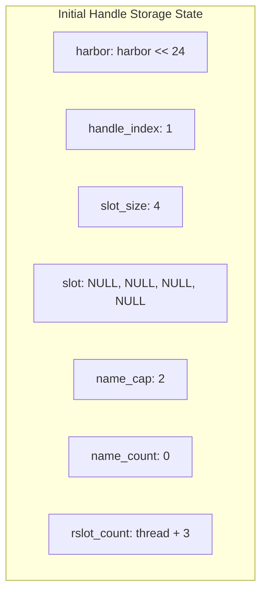
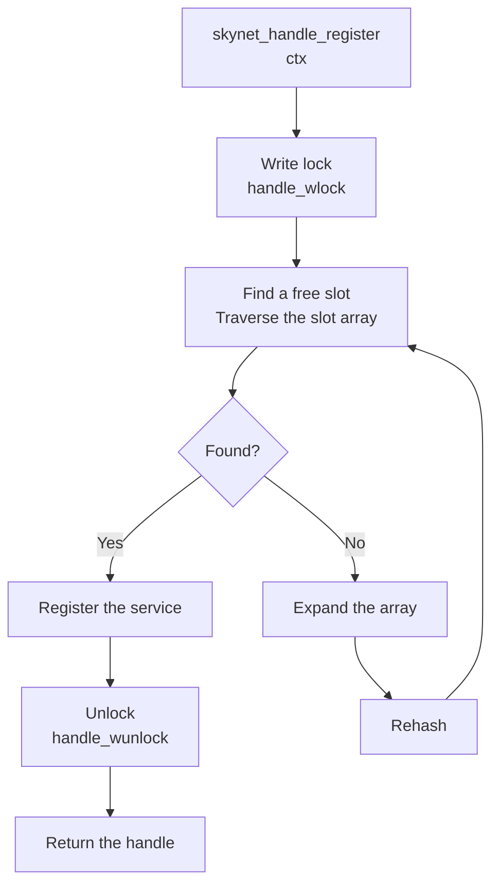
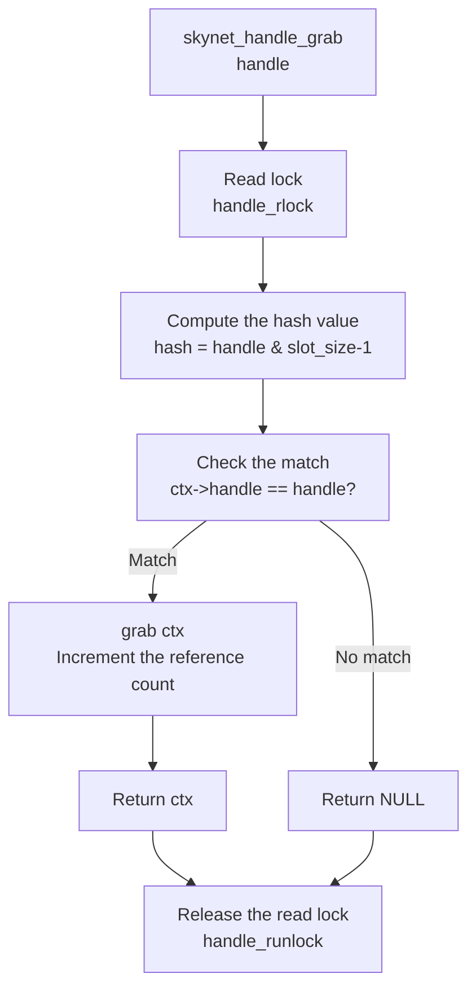
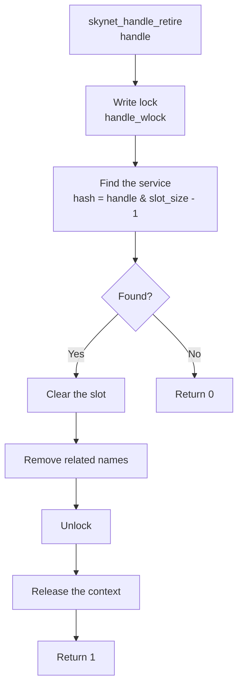
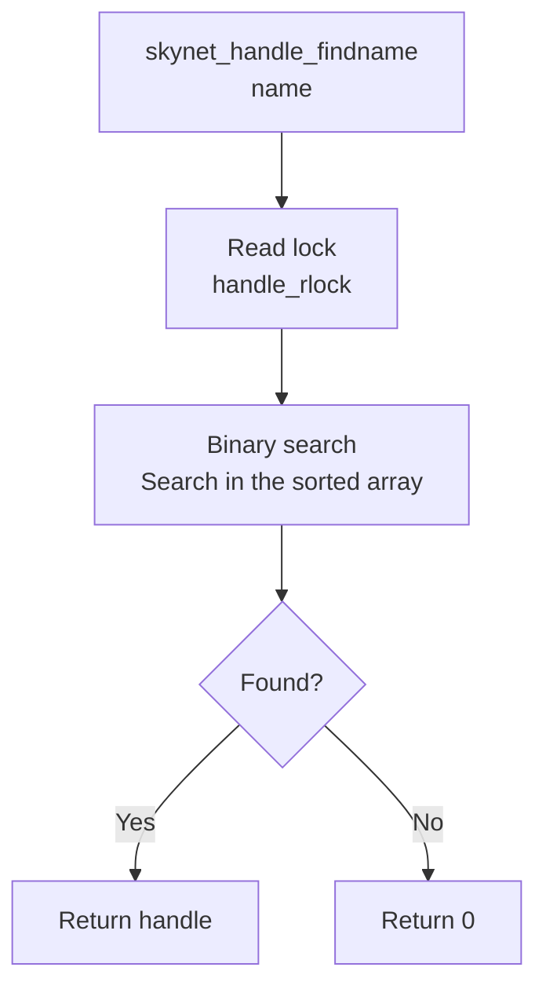
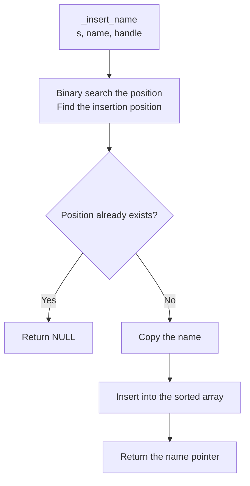

# skynet_handle.c Source Code Analysis

`skynet_handle.c` manages the handle mapping for services, and is a core component of the Skynet framework. In real projects, we found that this module's design directly affects the efficiency of service lookup and management.

## File Overview

**Responsibilities**: Service handle management, name service

**Core Data Structures**:
- `handle_storage` - Handle storage
- `handle_name` - Name mapping
- `handle_reader_slot` - Read lock optimization

**Key Functions**:
- `skynet_handle_register()` - Register a service
- `skynet_handle_grab()` - Get a service
- `skynet_handle_retire()` - Unregister a service
- `skynet_handle_findname()` - Find by name

## Core Data Structures

### handle_storage - Handle Storage

```c
struct handle_storage {
    struct rwlock lock;           // Read-write lock
    uint32_t harbor;             // Harbor ID
    uint32_t handle_index;       // Handle index
    int slot_size;               // Slot size
    struct skynet_context ** slot; // Service array
    
    int name_cap;                // Name capacity
    int name_count;              // Name count
    struct handle_name *name;    // Name array
    
    // Distributed read lock optimization
    ATOM_INT thread_idx;         // Thread index
    int rslot_count;             // Number of read slots
    struct handle_reader_slot *rslots; // Array of read slots
};
```

**Design Points**:

1. **Hash Table**: Uses a hash table to store service handle mappings
2. **Read-Write Lock**: Uses a read-write lock to ensure thread safety
3. **Name Service**: Supports finding services by name
4. **Distributed Read Lock**: Optimizes read operation performance

### handle_name - Name Mapping

```c
struct handle_name {
    char * name;      // Service name
    uint32_t handle;  // Service handle
};
```

### handle_reader_slot - Read Lock Optimization

```c
struct handle_reader_slot {
    ATOM_INT active;  // Whether active
    char _pad[HANDLE_CACHE_LINE - sizeof(ATOM_INT)]; // Cache line padding
};
```

## Initialization

### skynet_handle_init()

```c
void
skynet_handle_init(int harbor, int thread) {
    assert(H == NULL);
    
    // Allocate the storage structure
    struct handle_storage * s = skynet_malloc(sizeof(*H));
    
    // Initialize slots
    s->slot_size = DEFAULT_SLOT_SIZE;  // Default 4
    s->slot = skynet_malloc(s->slot_size * sizeof(struct skynet_context *));
    memset(s->slot, 0, s->slot_size * sizeof(struct skynet_context *));
    
    // Initialize the read-write lock
    rwlock_init(&s->lock);
    
    // Initialize distributed read slots
    // workers + monitor + timer + socket
    s->rslot_count = thread + 3;
    size_t rslot_sz = (size_t)s->rslot_count * sizeof(struct handle_reader_slot);
    s->rslots = (struct handle_reader_slot *)skynet_malloc(rslot_sz);
    memset(s->rslots, 0, rslot_sz);
    ATOM_INIT(&s->thread_idx, 0);
    
    // Set the Harbor ID
    s->harbor = (uint32_t)(harbor & 0xff) << HANDLE_REMOTE_SHIFT;
    
    // Initialize the handle index (0 is reserved for the system)
    s->handle_index = 1;
    
    // Initialize the name array
    s->name_cap = 2;
    s->name_count = 0;
    s->name = skynet_malloc(s->name_cap * sizeof(struct handle_name));
    
    H = s;
}
```

**Initial State**:



## Handle Management

### 1. Register a Handle - skynet_handle_register()

```c
uint32_t
skynet_handle_register(struct skynet_context *ctx) {
    struct handle_storage *s = H;
    
    handle_wlock(s);  // Write lock
    
    for (;;) {
        int i;
        uint32_t handle = s->handle_index;
        
        // 1. Find a free slot
        for (i = 0; i < s->slot_size; i++, handle++) {
            if (handle > HANDLE_MASK) {
                // Handle overflow, restart from 1
                handle = 1;
            }
            
            int hash = handle & (s->slot_size - 1);
            if (s->slot[hash] == NULL) {
                // 2. Found a free slot, register the service
                s->slot[hash] = ctx;
                s->handle_index = handle + 1;
                
                handle_wunlock(s);
                
                // 3. Add the Harbor ID
                handle |= s->harbor;
                return handle;
            }
        }
        
        // 4. No free slot, expand the array
        assert((s->slot_size * 2 - 1) <= HANDLE_MASK);
        struct skynet_context ** new_slot = skynet_malloc(s->slot_size * 2 * sizeof(struct skynet_context *));
        memset(new_slot, 0, s->slot_size * 2 * sizeof(struct skynet_context *));
        
        // 5. Rehash
        for (i = 0; i < s->slot_size; i++) {
            if (s->slot[i]) {
                int hash = skynet_context_handle(s->slot[i]) & (s->slot_size * 2 - 1);
                assert(new_slot[hash] == NULL);
                new_slot[hash] = s->slot[i];
            }
        }
        
        // 6. Replace the old array
        skynet_free(s->slot);
        s->slot = new_slot;
        s->slot_size *= 2;
    }
}
```

**Registration Flow**:



### 2. Get a Service - skynet_handle_grab()

```c
struct skynet_context *
skynet_handle_grab(uint32_t handle) {
    struct handle_storage *s = H;
    struct skynet_context * result = NULL;
    
    handle_rlock(s);  // Read lock
    
    // 1. Compute the hash value
    uint32_t hash = handle & (s->slot_size - 1);
    struct skynet_context * ctx = s->slot[hash];
    
    // 2. Check whether the handle matches
    if (ctx && skynet_context_handle(ctx) == handle) {
        result = ctx;
        skynet_context_grab(result);  // Increment the reference count
    }
    
    handle_runlock(s);  // Release the read lock
    
    return result;
}
```

**Grab Flow**:



### 3. Retire a Handle - skynet_handle_retire()

```c
int
skynet_handle_retire(uint32_t handle) {
    int ret = 0;
    struct handle_storage *s = H;
    
    handle_wlock(s);  // Write lock
    
    // 1. Compute the hash value
    uint32_t hash = handle & (s->slot_size - 1);
    struct skynet_context * ctx = s->slot[hash];
    
    // 2. Check whether the handle matches
    if (ctx != NULL && skynet_context_handle(ctx) == handle) {
        // 3. Clear the slot
        s->slot[hash] = NULL;
        ret = 1;
        
        // 4. Remove related names
        int i;
        int j = 0, n = s->name_count;
        for (i = 0; i < n; ++i) {
            if (s->name[i].handle == handle) {
                skynet_free(s->name[i].name);
                continue;
            } else if (i != j) {
                s->name[j] = s->name[i];
            }
            ++j;
        }
        s->name_count = j;
    } else {
        ctx = NULL;
    }
    
    handle_wunlock(s);  // Release the write lock
    
    // 5. Release the context (release outside the lock to avoid a deadlock)
    if (ctx) {
        skynet_context_release(ctx);
    }
    
    return ret;
}
```

**Retire Flow**:



### 4. Retire All - skynet_handle_retireall()

```c
void
skynet_handle_retireall() {
    struct handle_storage *s = H;
    
    for (;;) {
        int n = 0;
        int i;
        
        for (i = 0; i < s->slot_size; i++) {
            handle_rlock(s);
            struct skynet_context * ctx = s->slot[i];
            uint32_t handle = 0;
            
            if (ctx) {
                handle = skynet_context_handle(ctx);
                ++n;
            }
            
            handle_runlock(s);
            
            if (handle != 0) {
                skynet_handle_retire(handle);
            }
        }
        
        if (n == 0)
            return;
    }
}
```

## Name Service

### 1. Find a Name - skynet_handle_findname()

```c
uint32_t
skynet_handle_findname(const char * name) {
    struct handle_storage *s = H;
    
    handle_rlock(s);  // Read lock
    
    uint32_t handle = 0;
    
    // Binary search
    int begin = 0;
    int end = s->name_count - 1;
    
    while (begin <= end) {
        int mid = (begin + end) / 2;
        struct handle_name *n = &s->name[mid];
        int c = strcmp(n->name, name);
        
        if (c == 0) {
            handle = n->handle;
            break;
        }
        
        if (c < 0) {
            begin = mid + 1;
        } else {
            end = mid - 1;
        }
    }
    
    handle_runlock(s);  // Release the read lock
    
    return handle;
}
```

**Lookup Flow**:



### 2. Register a Name - skynet_handle_namehandle()

```c
const char *
skynet_handle_namehandle(uint32_t handle, const char *name) {
    handle_wlock(H);  // Write lock
    
    const char * ret = _insert_name(H, name, handle);
    
    handle_wunlock(H);  // Release the write lock
    
    return ret;
}

static const char *
_insert_name(struct handle_storage *s, const char * name, uint32_t handle) {
    // 1. Binary search for the insertion position
    int begin = 0;
    int end = s->name_count - 1;
    
    while (begin <= end) {
        int mid = (begin + end) / 2;
        struct handle_name *n = &s->name[mid];
        int c = strcmp(n->name, name);
        
        if (c == 0) {
            // The name already exists
            return NULL;
        }
        
        if (c < 0) {
            begin = mid + 1;
        } else {
            end = mid - 1;
        }
    }
    
    // 2. Copy the name
    char * result = skynet_strdup(name);
    
    // 3. Insert into the sorted array
    _insert_name_before(s, result, handle, begin);
    
    return result;
}
```

**Insertion Flow**:



### 3. Insert a Name - _insert_name_before()

```c
static void
_insert_name_before(struct handle_storage *s, char *name, uint32_t handle, int before) {
    if (s->name_count >= s->name_cap) {
        // 1. Expand the array
        s->name_cap *= 2;
        assert(s->name_cap <= MAX_SLOT_SIZE);
        
        struct handle_name * n = skynet_malloc(s->name_cap * sizeof(struct handle_name));
        
        // 2. Copy the data
        int i;
        for (i = 0; i < before; i++) {
            n[i] = s->name[i];
        }
        for (i = before; i < s->name_count; i++) {
            n[i+1] = s->name[i];
        }
        
        // 3. Free the old array
        skynet_free(s->name);
        s->name = n;
    } else {
        // 4. Move the data
        int i;
        for (i = s->name_count; i > before; i--) {
            s->name[i] = s->name[i-1];
        }
    }
    
    // 5. Insert the new data
    s->name[before].name = name;
    s->name[before].handle = handle;
    s->name_count++;
}
```

## Read Lock Optimization

### Distributed Read Lock

```c
static inline void
handle_rlock(struct handle_storage *s) {
    if (TLS_SLOT_IDX >= 0 && TLS_SLOT_IDX < s->rslot_count) {
        // Use the distributed read slot
        for (;;) {
            ATOM_STORE(&s->rslots[TLS_SLOT_IDX].active, 1);
            
            if (!ATOM_LOAD(&s->lock.write)) {
                break;  // No writer, the lock was acquired successfully
            }
            
            // A writer exists, back off
            ATOM_STORE(&s->rslots[TLS_SLOT_IDX].active, 0);
            while (ATOM_LOAD(&s->lock.write)) {
                atomic_pause_();
            }
        }
    } else {
        // Use the ordinary read-write lock
        rwlock_rlock(&s->lock);
    }
}

static inline void
handle_runlock(struct handle_storage *s) {
    if (TLS_SLOT_IDX >= 0 && TLS_SLOT_IDX < s->rslot_count) {
        // Clear the distributed read slot
        ATOM_STORE(&s->rslots[TLS_SLOT_IDX].active, 0);
    } else {
        // Release the ordinary read-write lock
        rwlock_runlock(&s->lock);
    }
}
```

### Writer Waits for Readers

```c
static inline void
handle_wlock(struct handle_storage *s) {
    rwlock_wlock(&s->lock);
    
    // Wait for all read slots to finish
    for (int i = 0; i < s->rslot_count; i++) {
        while (ATOM_LOAD(&s->rslots[i].active)) {
            atomic_pause_();
        }
    }
}
```

### Thread Registration

```c
void
skynet_handle_register_thread(void) {
    int idx = ATOM_FINC(&H->thread_idx);
    if (idx < H->rslot_count) {
        TLS_SLOT_IDX = idx;
    }
}
```

## Thread Safety

### Read-Write Lock Usage

```c
// Read operations
handle_rlock(s);
// ... read operations ...
handle_runlock(s);

// Write operations
handle_wlock(s);
// ... write operations ...
handle_wunlock(s);
```

### Atomic Operations

```c
// Distributed read slot
ATOM_INT active;
ATOM_STORE(&s->rslots[TLS_SLOT_IDX].active, 1);
ATOM_LOAD(&s->rslots[TLS_SLOT_IDX].active);
```

## Hash Table Design

### Hash Function

```c
int hash = handle & (s->slot_size - 1);
```

### Conflict Resolution

Uses open addressing with linear probing.

### Dynamic Expansion

```c
// Expand the array
struct skynet_context ** new_slot = skynet_malloc(s->slot_size * 2 * sizeof(struct skynet_context *));
memset(new_slot, 0, s->slot_size * 2 * sizeof(struct skynet_context *));

// Rehash
for (i = 0; i < s->slot_size; i++) {
    if (s->slot[i]) {
        int hash = skynet_context_handle(s->slot[i]) & (s->slot_size * 2 - 1);
        assert(new_slot[hash] == NULL);
        new_slot[hash] = s->slot[i];
    }
}

// Replace the old array
skynet_free(s->slot);
s->slot = new_slot;
s->slot_size *= 2;
```

## Interaction with Other Modules

### Interaction with skynet_server.c

```c
// Register a service
ctx->handle = skynet_handle_register(ctx);

// Get a service
struct skynet_context *ctx = skynet_handle_grab(handle);

// Unregister a service
skynet_handle_retire(handle);
```

### Interaction with skynet_mq.c

```c
// Look up a service by handle
struct skynet_context *ctx = skynet_handle_grab(handle);
if (ctx) {
    skynet_mq_push(ctx->queue, message);
    skynet_context_release(ctx);
}
```

## Key Design Decisions

### 1. Why Use a Hash Table?

- **O(1) Lookup**: Quickly look up a service by handle
- **Memory Efficiency**: Only store slots that hold a service
- **Dynamic Expansion**: Expand automatically as needed

### 2. Why Use a Read-Write Lock?

- **More Reads Than Writes**: Service lookups far outnumber registrations/retirements
- **Concurrent Reads**: Multiple threads can read simultaneously
- **Exclusive Writes**: Write operations require exclusive access

### 3. Why Use a Distributed Read Lock?

- **Reduced Contention**: Each thread has its own read slot
- **Cache Friendly**: Read slots are padded to a cache line
- **Lock-Free Reads**: Read operations do not need to acquire a global lock

## Performance Optimizations

### 1. Cache Line Padding

```c
struct handle_reader_slot {
    ATOM_INT active;
    char _pad[HANDLE_CACHE_LINE - sizeof(ATOM_INT)];
};
```

### 2. Binary Search

Name lookups use binary search with O(log n) complexity.

### 3. Batch Operations

```c
// Batch retirement
skynet_handle_retireall();
```

## Common Questions

### 1. What to Do About Handle Overflow?

The handle wraps back to 1 and keeps searching for a free slot.

### 2. What to Do About Duplicate Names?

Inserting a duplicate name returns NULL.

### 3. How Is Thread Safety Guaranteed?

By using a read-write lock together with the distributed read lock optimization.

## Next Steps

- [skynet_timer.c Analysis](/analysis/skynet-timer) - Timer implementation
- [socket_server.c Analysis](/analysis/socket-server) - Network I/O implementation
- [Services and Modules](/architecture/service-module) - Service management design
