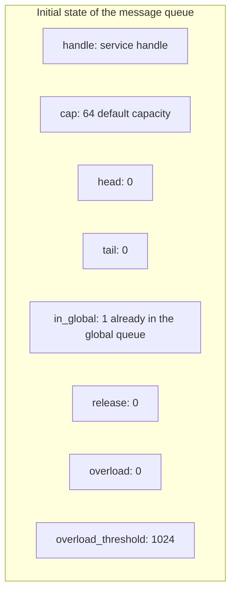
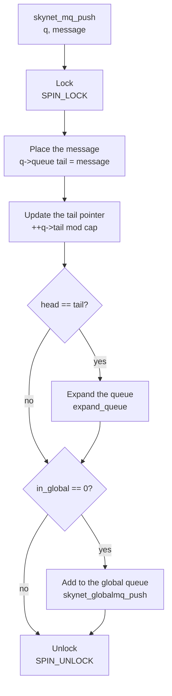
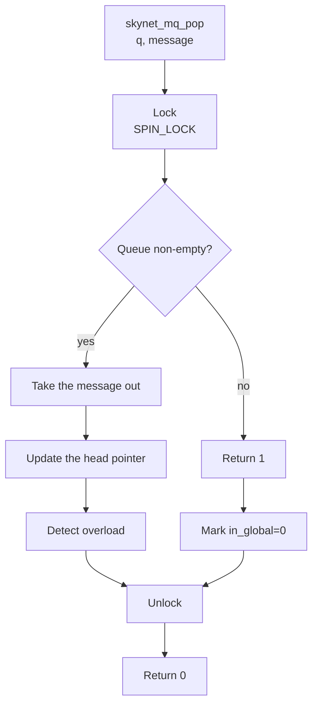
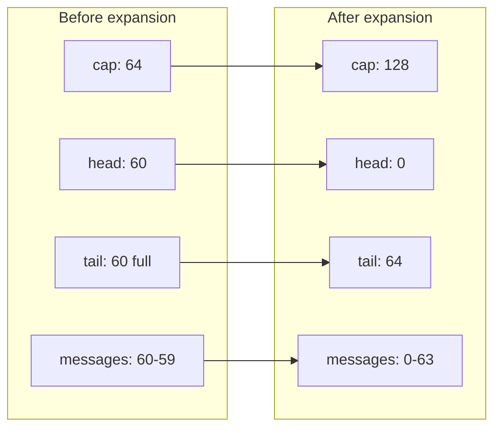
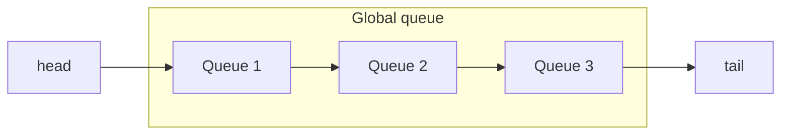
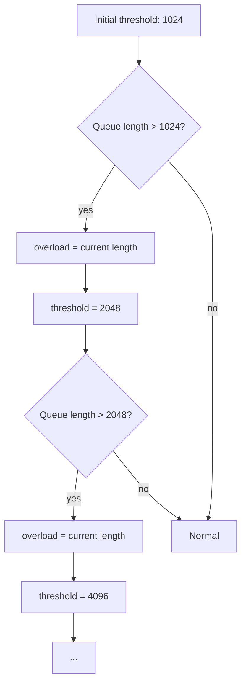
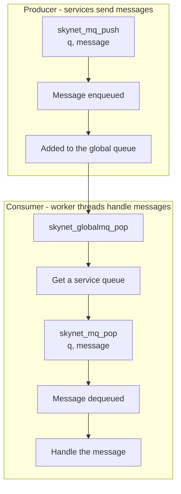

# Source Code Analysis of skynet_mq.c

`skynet_mq.c` implements Skynet's message queue system and is a core component of the whole framework. From experience across multiple projects, we have found that the design of the message queue directly affects system performance and stability.

## File Overview

**Responsibilities**: message queue management, global queue scheduling

**Core data structures**:
- `message_queue` - the service message queue
- `global_queue` - the global message queue

**Key functions**:
- `skynet_mq_create()` - create a message queue
- `skynet_mq_push()` - enqueue a message
- `skynet_mq_pop()` - dequeue a message
- `skynet_globalmq_push()` - add a queue to the global queue
- `skynet_globalmq_pop()` - take a queue from the global queue

## Core Data Structures

### message_queue - Service Message Queue

```c
struct message_queue {
    struct spinlock lock;     // spinlock
    uint32_t handle;         // the handle of the owning service
    int cap;                 // queue capacity
    int head;                // queue head
    int tail;                // queue tail
    int release;             // release flag
    int in_global;           // whether it is in the global queue
    int overload;            // overload count
    int overload_threshold;  // overload threshold
    struct skynet_message *queue; // message array
    struct message_queue *next;   // linked-list pointer
};
```

**Design points**:

1. **Ring buffer**: a ring buffer is implemented with head and tail
2. **Spinlock protection**: a spinlock guarantees thread safety
3. **Dynamic expansion**: the queue expands automatically when full
4. **Overload detection**: detects queue overload

### global_queue - Global Message Queue

```c
struct global_queue {
    struct message_queue *head; // head of the queue linked list
    struct message_queue *tail; // tail of the queue linked list
    struct spinlock lock;       // spinlock
};
```

**Design points**:

1. **Linked-list structure**: all service queues are managed with a singly linked list
2. **FIFO scheduling**: first in, first out, fair scheduling
3. **Spinlock protection**: guarantees thread safety

## Message Queue Lifecycle

### 1. Creating a Queue - skynet_mq_create()

```c
struct message_queue * 
skynet_mq_create(uint32_t handle) {
    // Allocate the queue structure
    struct message_queue *q = skynet_malloc(sizeof(*q));
    
    // Initialize properties
    q->handle = handle;
    q->cap = DEFAULT_QUEUE_SIZE;  // default capacity 64
    q->head = 0;
    q->tail = 0;
    SPIN_INIT(q)
    
    // Set flags
    q->in_global = MQ_IN_GLOBAL;  // avoid adding it to the global queue twice
    q->release = 0;
    q->overload = 0;
    q->overload_threshold = MQ_OVERLOAD;  // overload threshold 1024
    
    // Allocate the message array
    q->queue = skynet_malloc(sizeof(struct skynet_message) * q->cap);
    q->next = NULL;
    
    return q;
}
```

**Initial state**:



### 2. Releasing a Queue - skynet_mq_release()

```c
void 
skynet_mq_release(struct message_queue *q, message_drop drop_func, void *ud) {
    SPIN_LOCK(q)
    
    if (q->release) {
        // Marked for release, perform the release
        SPIN_UNLOCK(q)
        _drop_queue(q, drop_func, ud);
    } else {
        // Not marked for release, put it back in the global queue
        skynet_globalmq_push(q);
        SPIN_UNLOCK(q)
    }
}

static void
_drop_queue(struct message_queue *q, message_drop drop_func, void *ud) {
    struct skynet_message msg;
    
    // Drop all messages
    while(!skynet_mq_pop(q, &msg)) {
        drop_func(&msg, ud);
    }
    
    // Release the queue
    _release(q);
}

static void 
_release(struct message_queue *q) {
    assert(q->next == NULL);
    SPIN_DESTROY(q)
    skynet_free(q->queue);
    skynet_free(q);
}
```

### 3. Marking for Release - skynet_mq_mark_release()

```c
void 
skynet_mq_mark_release(struct message_queue *q) {
    SPIN_LOCK(q)
    assert(q->release == 0);
    q->release = 1;
    
    // If it is not in the global queue, add it to the global queue
    if (q->in_global != MQ_IN_GLOBAL) {
        skynet_globalmq_push(q);
    }
    
    SPIN_UNLOCK(q)
}
```

## Message Operations

### 1. Enqueueing a Message - skynet_mq_push()

```c
void 
skynet_mq_push(struct message_queue *q, struct skynet_message *message) {
    assert(message);
    SPIN_LOCK(q)
    
    // 1. Put the message at the tail of the queue
    q->queue[q->tail] = *message;
    if (++ q->tail >= q->cap) {
        q->tail = 0;  // ring buffer
    }
    
    // 2. Check whether expansion is needed
    if (q->head == q->tail) {
        expand_queue(q);
    }
    
    // 3. If it is not in the global queue, add it to the global queue
    if (q->in_global == 0) {
        q->in_global = MQ_IN_GLOBAL;
        skynet_globalmq_push(q);
    }
    
    SPIN_UNLOCK(q)
}
```

**Enqueue flow**:



### 2. Dequeueing a Message - skynet_mq_pop()

```c
int
skynet_mq_pop(struct message_queue *q, struct skynet_message *message) {
    int ret = 1;
    SPIN_LOCK(q)
    
    if (q->head != q->tail) {
        // 1. Take the message out
        *message = q->queue[q->head++];
        ret = 0;
        
        int head = q->head;
        int tail = q->tail;
        int cap = q->cap;
        
        // 2. Handle the ring buffer
        if (head >= cap) {
            q->head = head = 0;
        }
        
        // 3. Compute the queue length
        int length = tail - head;
        if (length < 0) {
            length += cap;
        }
        
        // 4. Detect overload
        while (length > q->overload_threshold) {
            q->overload = length;
            q->overload_threshold *= 2;
        }
    } else {
        // 5. Queue is empty, reset the overload threshold
        q->overload_threshold = MQ_OVERLOAD;
    }
    
    // 6. If the queue is empty, mark it as not being in the global queue
    if (ret) {
        q->in_global = 0;
    }
    
    SPIN_UNLOCK(q)
    
    return ret;
}
```

**Dequeue flow**:



### 3. Queue Expansion - expand_queue()

```c
static void
expand_queue(struct message_queue *q) {
    // 1. Allocate a new, larger array
    struct skynet_message *new_queue = skynet_malloc(sizeof(struct skynet_message) * q->cap * 2);
    
    // 2. Copy the messages into the new array
    int i;
    for (i=0; i<q->cap; i++) {
        new_queue[i] = q->queue[(q->head + i) % q->cap];
    }
    
    // 3. Update the pointers and the capacity
    q->head = 0;
    q->tail = q->cap;
    q->cap *= 2;
    
    // 4. Free the old array
    skynet_free(q->queue);
    q->queue = new_queue;
}
```

**Expansion process**:



## Global Queue Operations

### 1. Adding to the Global Queue - skynet_globalmq_push()

```c
void 
skynet_globalmq_push(struct message_queue * queue) {
    struct global_queue *q = Q;
    
    SPIN_LOCK(q)
    assert(queue->next == NULL);
    
    if(q->tail) {
        // The linked list is non-empty, append to the tail
        q->tail->next = queue;
        q->tail = queue;
    } else {
        // The linked list is empty, set it as both head and tail
        q->head = q->tail = queue;
    }
    
    SPIN_UNLOCK(q)
}
```

### 2. Taking from the Global Queue - skynet_globalmq_pop()

```c
struct message_queue * 
skynet_globalmq_pop() {
    struct global_queue *q = Q;
    
    SPIN_LOCK(q)
    struct message_queue *mq = q->head;
    
    if(mq) {
        // Take the head out
        q->head = mq->next;
        
        if(q->head == NULL) {
            // The linked list becomes empty
            assert(mq == q->tail);
            q->tail = NULL;
        }
        
        mq->next = NULL;
    }
    
    SPIN_UNLOCK(q)
    
    return mq;
}
```

**Global queue structure**:



## Overload Detection

### Overload Threshold

```c
#define MQ_OVERLOAD 1024

// Detect overload
while (length > q->overload_threshold) {
    q->overload = length;
    q->overload_threshold *= 2;
}
```

### Getting Overload Information

```c
int
skynet_mq_overload(struct message_queue *q) {
    if (q->overload) {
        int overload = q->overload;
        q->overload = 0;
        return overload;
    } 
    return 0;
}
```

**Overload threshold changes**:



## Queue Information Queries

### 1. Getting the Handle - skynet_mq_handle()

```c
uint32_t 
skynet_mq_handle(struct message_queue *q) {
    return q->handle;
}
```

### 2. Getting the Length - skynet_mq_length()

```c
int
skynet_mq_length(struct message_queue *q) {
    int head, tail, cap;
    
    SPIN_LOCK(q)
    head = q->head;
    tail = q->tail;
    cap = q->cap;
    SPIN_UNLOCK(q)
    
    if (head <= tail) {
        return tail - head;
    }
    return tail + cap - head;
}
```

## Initialization

```c
void 
skynet_mq_init() {
    struct global_queue *q = skynet_malloc(sizeof(*q));
    memset(q, 0, sizeof(*q));
    SPIN_INIT(q);
    Q = q;
}
```

## Thread Safety

### Using the Spinlock

```c
// Lock
SPIN_LOCK(q)
// ... critical section ...
SPIN_UNLOCK(q)

// Or
spinlock_lock(&q->lock);
// ... critical section ...
spinlock_unlock(&q->lock);
```

### Atomic Operations

```c
// Reading and writing the in_global flag
if (q->in_global == 0) {
    q->in_global = MQ_IN_GLOBAL;
    // ...
}
```

## Design Patterns

### 1. Ring Buffer

```c
// Enqueue
q->queue[q->tail] = message;
if (++q->tail >= q->cap) {
    q->tail = 0;
}

// Dequeue
message = q->queue[q->head];
if (++q->head >= q->cap) {
    q->head = 0;
}
```

### 2. Linked-List Queue

```c
// The global queue uses a linked list
struct message_queue *next;

// Enqueue
q->tail->next = queue;
q->tail = queue;

// Dequeue
mq = q->head;
q->head = mq->next;
```

### 3. Producer-Consumer



## Performance Optimization

### 1. Batch Processing

```c
// A worker thread handles multiple messages at once
for (int i = 0; i < batch_size; i++) {
    struct skynet_message *msg = skynet_mq_pop(q, &msg);
    if (msg) {
        // Handle the message
    }
}
```

### 2. Weighted Scheduling

```c
// Decide the number of messages to handle based on the queue length
int weight = skynet_mq_length(q) / global_mq_count;
if (weight == 0) weight = 1;
```

## Interaction with Other Modules

### Interaction with skynet_server.c

```c
// Create the queue when creating a service
ctx->queue = skynet_mq_create(handle);

// Enqueue when sending a message
skynet_mq_push(ctx->queue, message);

// Dequeue when handling a message
struct skynet_message *msg = skynet_mq_pop(q, &msg);
```

### Interaction with skynet_start.c

```c
// Initialize the global queue
skynet_mq_init();

// Worker threads take queues from the global queue
struct message_queue *q = skynet_globalmq_pop();
```

## Key Design Decisions

### 1. Why use a ring buffer?

- **Memory efficiency**: avoids frequent memory allocation and deallocation
- **Performance**: enqueue and dequeue operations are O(1)
- **Simplicity**: simple to implement and easy to understand

### 2. Why use a spinlock?

- **Low latency**: a spinlock performs better when the critical section is very short
- **Avoids context switches**: reduces the overhead of thread switching
- **Simplicity**: simple to implement and easy to understand

### 3. Why use a global queue?

- **Fair scheduling**: all services get processing opportunities fairly
- **Load balancing**: worker threads take queues from the global queue, which balances the load naturally
- **Simplicity**: avoids complex priority scheduling

## Frequently Asked Questions

### 1. What happens when the queue is full?

The queue expands automatically, growing to twice its original size.

### 2. How is overload detected?

It is detected through `overload_threshold`, which is adjusted dynamically.

### 3. How is thread safety guaranteed?

A spinlock protects all queue operations.

## Next Steps

- [Analysis of skynet_handle.c](/analysis/skynet-handle) - implementation of handle management
- [Analysis of skynet_timer.c](/analysis/skynet-timer) - implementation of the timer
- [Message-Driven Design](/architecture/message-driven) - design of the message system
