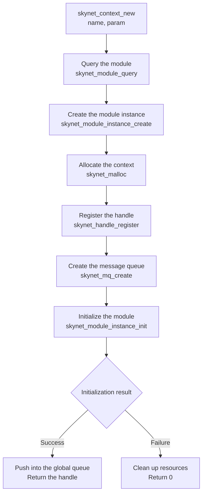
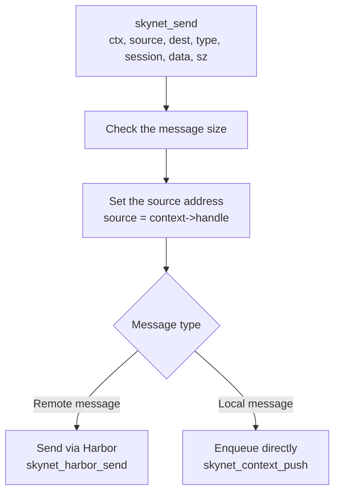

# Source Code Analysis of skynet_server.c

`skynet_server.c` is the core module of the Skynet framework, responsible for service creation, destruction, message handling, and scheduling. While reading the source code, we found that the design of this module is essential for understanding how Skynet works.

## File Overview

**Responsibility**: service management, message handling, service scheduling

**Core data structures**:
- `skynet_context` - service context
- `skynet_node` - node information

**Key functions**:
- `skynet_context_new()` - create a service
- `skynet_context_release()` - release a service
- `skynet_send()` - send a message
- `skynet_callback()` - set the callback function

## Core Data Structures

### skynet_context - Service Context

```c
struct skynet_context {
    void * instance;              // service instance (C module or Lua VM)
    struct skynet_module * mod;   // the module it belongs to
    void * cb_ud;                 // callback user data
    skynet_cb cb;                 // message callback function
    struct message_queue *queue;  // message queue
    ATOM_POINTER logfile;         // log file
    uint64_t cpu_cost;           // CPU cost (microseconds)
    uint64_t cpu_start;          // start time
    char result[32];             // result buffer
    uint32_t handle;             // service handle (unique identifier)
    int session_id;              // session ID counter
    ATOM_INT ref;                // reference count
    size_t message_count;        // message count
    bool init;                   // whether it is initialized
    bool endless;                // whether it is stuck in an endless loop
    bool profile;                // whether profiling is enabled
};
```

**Design points**:

1. **Reference counting**: the lifecycle is managed with an atomically updated reference count
2. **Dedicated message queue**: every service has its own message queue
3. **Performance monitoring**: built-in CPU cost statistics
4. **Callback function**: messages are handled through a callback function

### skynet_node - Node Information

```c
struct skynet_node {
    ATOM_INT total;          // total number of services
    int init;                // initialization flag
    uint32_t monitor_exit;   // the service monitored for exit
    pthread_key_t handle_key; // thread-local storage
    bool profile;            // whether profiling is enabled
};
```

## Service Lifecycle

### 1. Creating a Service - skynet_context_new()

```c
uint32_t
skynet_context_new(const char * name, const char *param) {
    // 1. Query the module
    struct skynet_module * mod = skynet_module_query(name);
    if (mod == NULL)
        return 0;

    // 2. Create the module instance
    void *inst = skynet_module_instance_create(mod);
    if (inst == NULL)
        return 0;

    // 3. Allocate the context
    struct skynet_context * ctx = skynet_malloc(sizeof(*ctx));

    // 4. Initialize the context
    ctx->mod = mod;
    ctx->instance = inst;
    ATOM_INIT(&ctx->ref, 2);  // Two references: register + init
    ctx->cb = NULL;
    ctx->cb_ud = NULL;
    ctx->session_id = 0;
    ctx->init = false;
    ctx->endless = false;
    ctx->cpu_cost = 0;
    ctx->cpu_start = 0;
    ctx->message_count = 0;
    ctx->profile = G_NODE.profile;

    // 5. Register the handle
    ctx->handle = 0;
    const uint32_t handle = skynet_handle_register(ctx);
    ctx->handle = handle;

    // 6. Create the message queue
    struct message_queue * queue = ctx->queue = skynet_mq_create(handle);

    // 7. Initialize the module
    context_inc();
    int r = skynet_module_instance_init(mod, inst, ctx, param);

    if (r == 0) {
        // 8. Initialization succeeded
        ctx->init = true;
        skynet_globalmq_push(queue);  // push into the global queue
        skynet_error(ctx, "LAUNCH %s %s", name, param ? param : "");
        skynet_context_release(ctx);  // release the init reference
        return handle;
    } else {
        // 9. Initialization failed
        skynet_error(ctx, "error: launch %s FAILED", name);
        uint32_t handle = ctx->handle;
        skynet_context_release(ctx);
        skynet_handle_retire(handle);
        struct drop_t d = { handle };
        skynet_mq_release(queue, drop_message, &d);
        return 0;
    }
}
```

**Flowchart**:



### 2. Destroying a Service - skynet_context_release()

```c
static void
delete_context(struct skynet_context *ctx) {
    // Close the log file
    FILE *f = (FILE *)ATOM_LOAD(&ctx->logfile);
    if (f) {
        fclose(f);
    }

    // Release the module instance
    skynet_module_instance_release(ctx->mod, ctx->instance);

    // Mark the message queue for release
    skynet_mq_mark_release(ctx->queue);

    // Free the context
    skynet_free(ctx);

    // Decrement the node's service count
    context_dec();
}

void
skynet_context_release(struct skynet_context *ctx) {
    // Atomically decrement the reference count
    if (ATOM_FDEC(&ctx->ref) == 1) {
        // The reference count reaches 0, delete the context
        delete_context(ctx);
    }
}
```

**Reference counting mechanism**:


### 3. Reference Management - skynet_context_grab()

```c
void
skynet_context_grab(struct skynet_context *ctx) {
    ATOM_FINC(&ctx->ref);
}

void
skynet_context_reserve(struct skynet_context *ctx) {
    skynet_context_grab(ctx);
    // Not counted in the total, because the reserved context is released at the end
    context_dec();
}
```

## Message Handling

### 1. Sending a Message - skynet_send()

```c
int
skynet_send(struct skynet_context * context, uint32_t source, uint32_t destination, int type, int session, void * data, size_t sz) {
    // Check the message type flags
    if ((sz & MESSAGE_TYPE_MASK) != sz) {
        skynet_error(context, "The message to %x is too large", destination);
        if (type & PTYPE_TAG_DONTCOPY) {
            skynet_free(data);
        }
        return -2;
    }

    // Check whether it is a local message
    if (source == 0) {
        source = context->handle;
    }

    // Check whether release is needed
    if (skynet_harbor_message_isremote(destination)) {
        // Remote message, send it through Harbor
        struct skynet_message smsg;
        smsg.source = source;
        smsg.session = session;
        smsg.data = data;
        smsg.sz = sz;
        skynet_harbor_send(&smsg, destination);
    } else {
        // Local message, push it directly into the queue
        struct skynet_message smsg;
        smsg.source = source;
        smsg.session = session;
        smsg.data = data;
        smsg.sz = sz;
        skynet_context_push(destination, &smsg);
    }

    return session;
}
```

**Message sending flow**:



### 2. Pushing a Message into the Queue - skynet_context_push()

```c
int
skynet_context_push(uint32_t handle, struct skynet_message *message) {
    // Get the service context
    struct skynet_context * ctx = skynet_handle_grab(handle);
    if (ctx == NULL) {
        return -1;
    }

    // Push into the message queue
    skynet_mq_push(ctx->queue, message);

    // Release the context reference
    skynet_context_release(ctx);

    return 0;
}
```

### 3. Dispatching Messages - skynet_context_message_dispatch()

```c
struct skynet_message *
skynet_context_message_dispatch(struct skynet_monitor *sm, struct skynet_message *msg, int weight) {
    // Check whether it is an exit message
    if (msg->source == 0) {
        // System message
        if (msg->session == 0) {
            // Exit message
            skynet_handle_retire(msg->destination);
            return NULL;
        }
    }

    // Get the target service
    struct skynet_context * ctx = skynet_handle_grab(msg->destination);
    if (ctx == NULL) {
        // The target service does not exist, drop the message
        skynet_free(msg->data);
        return NULL;
    }

    // Check whether it is an endless-loop service
    if (ctx->endless) {
        // Endless-loop service, do not process the message
        skynet_free(msg->data);
        skynet_context_release(ctx);
        return NULL;
    }

    // Start processing the message
    int type = msg->sz >> MESSAGE_TYPE_SHIFT;
    size_t sz = msg->sz & MESSAGE_TYPE_MASK;

    // Performance monitoring
    if (ctx->profile) {
        ctx->cpu_start = skynet_thread_time();
    }

    // Call the callback function
    CHECKCALLING_BEGIN(ctx)
    int err = ctx->cb(ctx, ctx->cb_ud, type, msg->session, msg->source, msg->data, sz);
    CHECKCALLING_END(ctx)

    // Update the performance statistics
    if (ctx->profile) {
        ctx->cpu_cost += skynet_thread_time() - ctx->cpu_start;
    }

    // Update the message count
    ++ctx->message_count;

    // Release the context reference
    skynet_context_release(ctx);

    return NULL;
}
```

## Callback Function Management

### Setting the Callback Function - skynet_callback()

```c
void
skynet_callback(struct skynet_context * context, void *ud, skynet_cb cb) {
    // Set the user data
    context->cb_ud = ud;

    // Set the callback function
    context->cb = cb;
}
```

**Callback function type**:

```c
typedef int (*skynet_cb)(
    struct skynet_context * ctx,   // service context
    void * ud,                      // user data
    int type,                       // message type
    int session,                    // session ID
    uint32_t source,               // message source
    const void * msg,              // message content
    size_t sz                      // message size
);
```

## Service Lookup

### Lookup by Handle - skynet_handle_grab()

```c
// Implemented in skynet_handle.c
struct skynet_context *
skynet_handle_grab(uint32_t handle) {
    struct handle_storage *s = H;
    rwlock_rlock(&s->lock);

    struct skynet_context *result = NULL;
    int index = handle & (s->slot_size - 1);
    struct skynet_context *ctx = s->slot[index];

    if (ctx && ctx->handle == handle) {
        result = ctx;
        skynet_context_grab(result);
    }

    rwlock_runlock(&s->lock);
    return result;
}
```

### Lookup by Name - skynet_handle_findname()

```c
uint32_t
skynet_handle_findname(const char * name) {
    struct handle_storage *s = H;
    rwlock_rlock(&s->lock);

    uint32_t handle = 0;
    int i;
    for (i=0; i<s->name_count; i++) {
        if (strcmp(s->name[i].name, name) == 0) {
            handle = s->name[i].handle;
            break;
        }
    }

    rwlock_runlock(&s->lock);
    return handle;
}
```

## Endless Loop Detection

### Marking an Endless Loop - skynet_context_endless()

```c
void
skynet_context_endless(uint32_t handle) {
    struct skynet_context * ctx = skynet_handle_grab(handle);
    if (ctx == NULL) {
        return;
    }
    ctx->endless = true;
    skynet_context_release(ctx);
}
```

### Checking for Endless Loops

```c
// Checked during message dispatch
if (ctx->endless) {
    // Endless-loop service, do not process the message
    skynet_free(msg->data);
    skynet_context_release(ctx);
    return NULL;
}
```

## Performance Monitoring

### CPU Cost Statistics

```c
// Measured before and after message processing
if (ctx->profile) {
    ctx->cpu_start = skynet_thread_time();
}

// Call the callback function
int err = ctx->cb(ctx, ctx->cb_ud, type, msg->session, msg->source, msg->data, sz);

if (ctx->profile) {
    ctx->cpu_cost += skynet_thread_time() - ctx->cpu_start;
}

++ctx->message_count;
```

### Getting Performance Data

```c
// Implemented in skynet_monitor.c
void
skynet_monitor_check(struct skynet_monitor *sm) {
    // Check the CPU cost of each service
    // ...
}
```

## Error Handling

### Handling Dropped Messages

```c
struct drop_t {
    uint32_t handle;
};

static void
drop_message(struct skynet_message *msg, void *ud) {
    struct drop_t *d = ud;

    // Free the message data
    skynet_free(msg->data);

    // Send an error notification to the message source
    uint32_t source = d->handle;
    assert(source);
    skynet_send(NULL, source, msg->source, PTYPE_ERROR, msg->session, NULL, 0);
}
```

### Handling Creation Failures

```c
if (r == 0) {
    // Initialization succeeded
    ctx->init = true;
    skynet_globalmq_push(queue);
    skynet_error(ctx, "LAUNCH %s %s", name, param ? param : "");
    skynet_context_release(ctx);
    return handle;
} else {
    // Initialization failed
    skynet_error(ctx, "error: launch %s FAILED", name);
    uint32_t handle = ctx->handle;
    skynet_context_release(ctx);
    skynet_handle_retire(handle);
    struct drop_t d = { handle };
    skynet_mq_release(queue, drop_message, &d);
    return 0;
}
```

## Thread Safety

### Atomic Operations

```c
// The reference count uses atomic operations
ATOM_INT ref;

// Increment the reference
void skynet_context_grab(struct skynet_context *ctx) {
    ATOM_FINC(&ctx->ref);
}

// Decrement the reference
void skynet_context_release(struct skynet_context *ctx) {
    if (ATOM_FDEC(&ctx->ref) == 1) {
        delete_context(ctx);
    }
}
```

### Read-Write Lock

```c
// The handle table is protected by a read-write lock
rwlock_rlock(&s->lock);   // read operation
rwlock_runlock(&s->lock);
rwlock_wlock(&s->lock);   // write operation
rwlock_wunlock(&s->lock);
```

## Design Patterns

### 1. Reference Counting Pattern

```c
// Lifecycle management
struct skynet_context *ctx = skynet_handle_grab(handle);
if (ctx) {
    // Use ctx
    skynet_context_release(ctx);
}
```

### 2. Callback Function Pattern

```c
// Register the callback
skynet_callback(context, ud, callback_function);

// Call the callback
ctx->cb(ctx, ctx->cb_ud, type, session, source, data, sz);
```

### 3. Producer-Consumer Pattern

```c
// Producer: send a message
skynet_send(context, source, dest, type, session, data, sz);

// Consumer: process the message
skynet_context_message_dispatch(sm, msg, weight);
```

## Performance Optimizations

### 1. Batch Processing

```c
// Process multiple messages at once
for (i = 0; i < n; i++) {
    struct skynet_message *msg = skynet_mq_pop(q);
    if (msg) {
        skynet_context_message_dispatch(sm, msg, weight);
    }
}
```

### 2. Weighted Scheduling

```c
// Decide how many messages to process based on the weight
int weight = skynet_mq_length(q) / global_mq_count;
if (weight == 0) weight = 1;
```

## Interaction with Other Modules

### Interaction with skynet_mq.c

```c
// Create the message queue
ctx->queue = skynet_mq_create(handle);

// Push a message
skynet_mq_push(ctx->queue, message);

// Pop a message
struct skynet_message *msg = skynet_mq_pop(ctx->queue);
```

### Interaction with skynet_handle.c

```c
// Register the handle
ctx->handle = skynet_handle_register(ctx);

// Look up a service
struct skynet_context *ctx = skynet_handle_grab(handle);

// Retire the handle
skynet_handle_retire(handle);
```

### Interaction with skynet_module.c

```c
// Query the module
struct skynet_module *mod = skynet_module_query(name);

// Create the instance
void *inst = skynet_module_instance_create(mod);

// Initialize the instance
int r = skynet_module_instance_init(mod, inst, ctx, param);

// Release the instance
skynet_module_instance_release(ctx->mod, ctx->instance);
```

## Key Design Decisions

### 1. Why use reference counting?

- **Thread safety**: atomic operations guarantee thread safety
- **Automatic release**: resources are released automatically when the reference count reaches 0
- **No circular references**: circular references are avoided through design

### 2. Why use callback functions?

- **Decoupling**: service logic is decoupled from the framework
- **Flexibility**: the callback function can be set dynamically
- **Polymorphism**: different types of services can have different callbacks

### 3. Why does each service have its own message queue?

- **Isolation**: services do not interfere with each other
- **Fair scheduling**: every service gets a fair chance to be processed
- **Simple design**: complex lock contention is avoided

## Next Steps

- [Analysis of skynet_mq.c](/analysis/skynet-mq) - implementation details of the message queue
- [Analysis of skynet_handle.c](/analysis/skynet-handle) - implementation of handle management
- [Service Scheduling](/architecture/service-scheduling) - understand how worker threads schedule services
