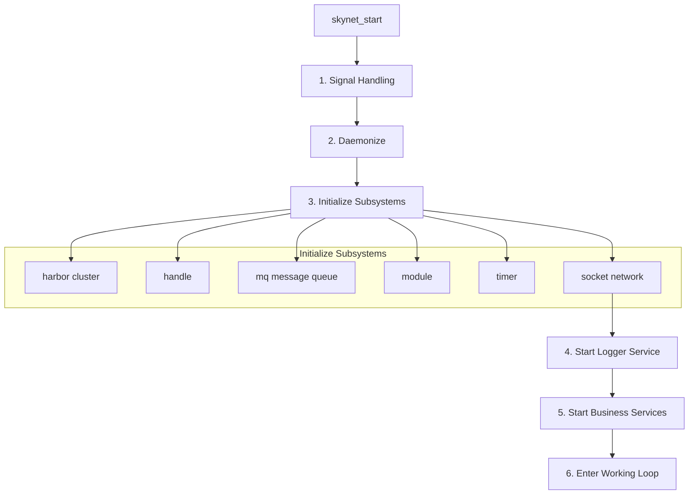
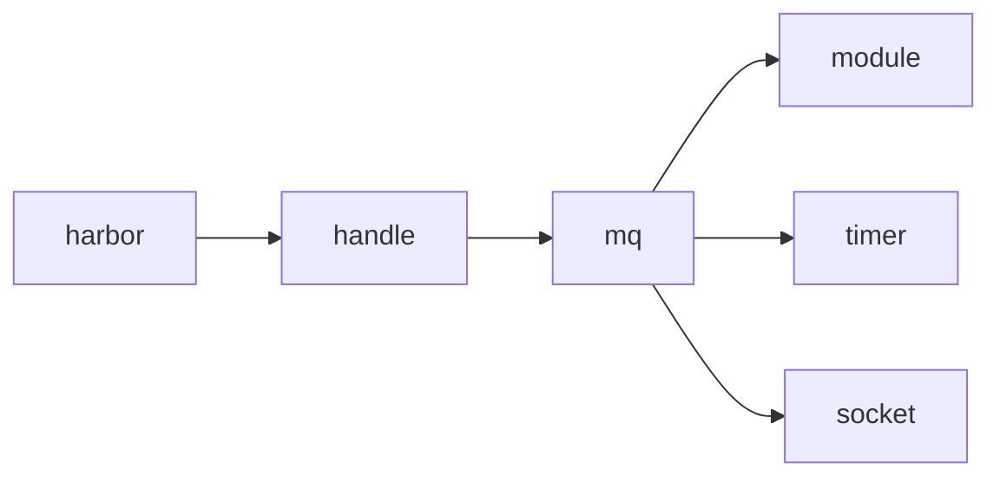

# Source Code Analysis of skynet_start.c

`skynet_start.c` is the startup entry point of Skynet, responsible for initializing all subsystems, creating worker threads, and entering the main loop. In actual deployments, the design of the startup flow directly affects service stability and observability.

## Overall Flow

The design philosophy of the startup flow is: **initialize the infrastructure first, then start business services, and finally enter the working loop**.



## Core Data Structures

### monitor - Monitor Structure

```c
struct monitor {
    int count;                      // number of worker threads
    struct skynet_monitor ** m;     // a monitor for each thread
    pthread_cond_t cond;            // condition variable
    pthread_mutex_t mutex;          // mutex lock
    int sleep;                      // number of sleeping threads
    int quit;                       // quit flag
};
```

**Design experience**:

- Each worker thread has an independent monitor, avoiding lock contention
- The `sleep` count is used to decide whether threads need to be woken up
- The `quit` flag is used for graceful shutdown

### worker_parm - Worker Thread Parameters

```c
struct worker_parm {
    struct monitor *m;
    int id;           // thread ID
    int weight;       // weight
};
```

**Design experience**:

- The weight mechanism is used for load balancing; threads with higher weights handle more messages
- Weight array design: `[-1,-1,-1,-1, 0,0,0,0, 1,1,1,1, 2,2,2,2, 3,3,3,3]`
- A weight of -1 means the thread preferentially sleeps when idle; a weight of 3 means it tries not to sleep at all

## Subsystem Initialization

### The skynet_start() Function

```c
void
skynet_start(struct skynet_config * config) {
    // 1. Register the SIGHUP signal (used for log rotation)
    struct sigaction sa;
    sa.sa_handler = &handle_hup;
    sa.sa_flags = SA_RESTART;
    sigfillset(&sa.sa_mask);
    sigaction(SIGHUP, &sa, NULL);
    
    // 2. Daemonize
    if (config->daemon) {
        if (daemon_init(config->daemon)) {
            exit(1);
        }
    }
    
    // 3. Initialize subsystems (order matters a lot)
    skynet_harbor_init(config->harbor);    // cluster
    skynet_handle_init(config->harbor, config->thread);  // handles
    skynet_mq_init();                      // message queue
    skynet_module_init(config->module_path);  // module loading
    skynet_timer_init();                   // timer
    skynet_socket_init();                  // network
    skynet_profile_enable(config->profile); // profiling
    
    // 4. Start the logger service (must be started first)
    const uint32_t logger_handle = skynet_context_new(config->logservice, config->logger);
    if (logger_handle == 0) {
        fprintf(stderr, "Can't launch %s service\n", config->logservice);
        exit(1);
    }
    skynet_handle_namehandle(logger_handle, "logger");
    
    // 5. Start business services
    bootstrap(logger_handle, config->bootstrap);
    
    // 6. Enter the working loop
    start(config->thread);
    
    // 7. Cleanup
    skynet_harbor_exit();
    skynet_socket_free();
    if (config->daemon) {
        daemon_exit(config->daemon);
    }
}
```

**Summary of experience**:

1. **Initialization order**: handle -> mq -> module -> timer -> socket, because there are dependencies
2. **Logger service first**: ensures that logs produced during the later initialization steps are printed properly
3. **SIGHUP signal**: used for log rotation; sending SIGHUP notifies the logger to reopen the log file
4. **SA_RESTART**: system calls interrupted by a signal are restarted automatically, avoiding EINTR errors

### Subsystem Dependencies



## Worker Threads

### thread_worker - The Worker Thread Main Loop

```c
static void *
thread_worker(void *p) {
    struct worker_parm *wp = p;
    int id = wp->id;
    int weight = wp->weight;
    struct monitor *m = wp->m;
    struct skynet_monitor *sm = m->m[id];
    
    // Initialize thread-local storage
    skynet_initthread(THREAD_WORKER);
    skynet_handle_register_thread();
    
    struct message_queue * q = NULL;
    while (!m->quit) {
        // Dispatch messages
        q = skynet_context_message_dispatch(sm, q, weight);
        
        if (q == NULL) {
            // No messages, go to sleep
            if (pthread_mutex_lock(&m->mutex) == 0) {
                ++ m->sleep;
                if (!m->quit)
                    pthread_cond_wait(&m->cond, &m->mutex);
                -- m->sleep;
                if (pthread_mutex_unlock(&m->mutex)) {
                    fprintf(stderr, "unlock mutex error");
                    exit(1);
                }
            }
        }
    }
    return NULL;
}
```

**Summary of experience**:

1. **Thread-local storage**: `skynet_initthread` sets the thread type, used for debugging
2. **Handle registration**: `skynet_handle_register_thread` registers a distributed read-lock slot
3. **Message queue reuse**: `q` is kept alive outside the loop, avoiding repeatedly fetching from the global queue
4. **Condition variable waiting**: the thread sleeps when there are no messages and is woken up when messages arrive

### The Weight Mechanism

```c
static int weight[] = {
    -1, -1, -1, -1, 0, 0, 0, 0,
    1, 1, 1, 1, 1, 1, 1, 1,
    2, 2, 2, 2, 2, 2, 2, 2,
    3, 3, 3, 3, 3, 3, 3, 3,
};
```

**Weight meanings**:

| Weight | Behavior |
|--------|----------|
| -1 | Prefer to sleep when idle, saving CPU |
| 0 | Default behavior |
| 1 | Try not to sleep, stay active |
| 2 | Handle messages more aggressively |
| 3 | Highest priority, almost never sleeps |

**Summary of experience**:

- The first 4 threads have weight -1, suitable for low-priority tasks
- The last 8 threads have weight 3, suitable for high-priority tasks
- The weight influences scheduling through the `weight` parameter of `skynet_context_message_dispatch`

## Auxiliary Threads

### thread_timer - Timer Thread

```c
static void *
thread_timer(void *p) {
    struct monitor * m = p;
    skynet_initthread(THREAD_TIMER);
    skynet_handle_register_thread();
    
    for (;;) {
        // Update time
        skynet_updatetime();
        skynet_socket_updatetime();
        
        CHECK_ABORT
        
        // Wake up worker threads
        wakeup(m, m->count - 1);
        
        // Update once every 2.5ms
        usleep(2500);
        
        // Handle the SIGHUP signal
        if (SIG) {
            signal_hup();
            SIG = 0;
        }
    }
    
    // Shutdown handling
    skynet_socket_exit();
    pthread_mutex_lock(&m->mutex);
    m->quit = 1;
    pthread_cond_broadcast(&m->cond);
    pthread_mutex_unlock(&m->mutex);
    return NULL;
}
```

**Summary of experience**:

1. **2.5ms precision**: timer precision is 10ms (usleep 2500 * 4 times per 10ms)
2. **Wakeup strategy**: `wakeup(m, m->count-1)` wakes up all threads except one
3. **Signal handling**: SIGHUP is handled in the timer thread to avoid race conditions
4. **Graceful shutdown**: exit the socket first, then set the quit flag, and finally broadcast to wake everyone up

### thread_socket - Network Thread

```c
static void *
thread_socket(void *p) {
    struct monitor * m = p;
    skynet_initthread(THREAD_SOCKET);
    skynet_handle_register_thread();
    
    for (;;) {
        int r = skynet_socket_poll();
        if (r == 0)
            break;
        if (r < 0) {
            CHECK_ABORT
            continue;
        }
        wakeup(m, 0);
    }
    return NULL;
}
```

**Summary of experience**:

1. **Independent thread**: network I/O runs in an independent thread and does not block business logic
2. **Wakeup strategy**: `wakeup(m, 0)` wakes up at least one thread
3. **Error handling**: when `r < 0`, check whether the thread needs to exit

### thread_monitor - Monitor Thread

```c
static void *
thread_monitor(void *p) {
    struct monitor * m = p;
    int i;
    int n = m->count;
    skynet_initthread(THREAD_MONITOR);
    skynet_handle_register_thread();
    
    for (;;) {
        CHECK_ABORT
        
        // Check every worker thread
        for (i = 0; i < n; i++) {
            skynet_monitor_check(m->m[i]);
        }
        
        // Check once every 5 seconds
        for (i = 0; i < 5; i++) {
            CHECK_ABORT
            sleep(1);
        }
    }
    return NULL;
}
```

**Summary of experience**:

1. **Infinite-loop detection**: checks whether a worker thread is stuck on some message processing
2. **5-second interval**: balances detection precision against performance overhead
3. **CHECK_ABORT**: checks once per second whether the system needs to exit

## Starting Services

### bootstrap - Starting Business Services

```c
static void
bootstrap(uint32_t logger_handle, const char * cmdline) {
    int sz = strlen(cmdline);
    char name[sz+1];
    char args[sz+1];
    int arg_pos;
    
    // Parse the command line
    sscanf(cmdline, "%s", name);
    arg_pos = strlen(name);
    if (arg_pos < sz) {
        while (cmdline[arg_pos] == ' ') {
            arg_pos++;
        }
        strncpy(args, cmdline + arg_pos, sz);
    } else {
        args[0] = '\0';
    }
    
    // Create the service
    const uint32_t handle = skynet_context_new(name, args);
    if (handle == 0) {
        // Startup failed; print a log and then exit
        struct skynet_context *logger = skynet_handle_grab(logger_handle);
        if (logger != NULL) {
            skynet_error(NULL, "Bootstrap error : %s\n", cmdline);
            skynet_context_dispatchall(logger);
            skynet_context_release(logger);
        }
        exit(1);
    }
}
```

**Summary of experience**:

1. **Command format**: `service name arguments`, separated by a space
2. **Error handling**: on startup failure the system prints a log before exiting, which makes troubleshooting easier
3. **dispatchall**: forces all pending log messages to be processed

## Thread Wakeup Mechanism

### The wakeup Function

```c
static void
wakeup(struct monitor *m, int busy) {
    if (m->sleep >= m->count - busy) {
        pthread_cond_signal(&m->cond);
    }
}
```

**Wakeup strategy**:

| Scenario | busy value | Number woken up |
|----------|------------|------------------|
| Socket event | 0 | All sleeping threads |
| Timer | count-1 | All threads except one |
| Normal case | 0 | Wake up as needed |

**Summary of experience**:

- `pthread_cond_signal` only wakes up one thread
- A "spurious wakeup" is harmless
- The timer thread keeps one thread awake so as not to over-wake everyone

## Shutdown Flow

```
Shutdown flow:
    1. The timer thread detects the quit flag
    2. It calls skynet_socket_exit() to notify the socket thread to exit
    3. Set m->quit = 1
    4. pthread_cond_broadcast wakes up all worker threads
    5. All threads exit once they detect the quit flag
    6. pthread_join waits for all threads to finish
    7. Resources are cleaned up
```

**Summary of experience**:

- Exit the socket thread first, so no data is being sent during shutdown
- Broadcast to wake up all threads, ensuring that everyone exits
- Join all threads, ensuring that resources are released

## The CHECK_ABORT Macro

```c
#define CHECK_ABORT if (skynet_context_total()==0) break;
```

**Design intent**:

- When all services have exited, the whole system exits
- It is checked in every thread's loop to ensure a timely exit
- Prevents zombie processes

## Relationship with Configuration

```c
struct skynet_config {
    int thread;           // number of worker threads
    int harbor;           // cluster ID
    const char * daemon;  // daemon path
    const char * module_path; // module path
    const char * bootstrap;   // bootstrap service
    const char * logservice;  // logger service
    const char * logger;      // logger arguments
    bool profile;             // profiling
};
```

**Configuration recommendations**:

| Setting | Recommended value | Description |
|---------|-------------------|-------------|
| thread | Number of CPU cores | Fully utilize multiple cores |
| harbor | 0 | Single-machine mode |
| daemon | NULL | Disable while debugging |
| profile | true | Enable in development environments |

## Frequently Asked Questions

### 1. Why must the logger service be started first?

Log output during the later initialization steps depends on the logger service.

### 2. Why use usleep(2500) instead of a more precise timer?

usleep is cheap, and 2.5ms precision is good enough for a game server.

### 3. How do you adjust the number of threads?

Adjust it based on the number of CPU cores and the characteristics of the workload; in general it equals the number of CPU cores.

### 4. How do you troubleshoot startup failures?

Check the log output; a bootstrap failure prints an error message.

## Next Steps

- [Analysis of skynet_server.c](/analysis/skynet-server) - service management
- [Analysis of skynet_mq.c](/analysis/skynet-mq) - message queue
- [Architecture Overview](/architecture/overview) - overall design
