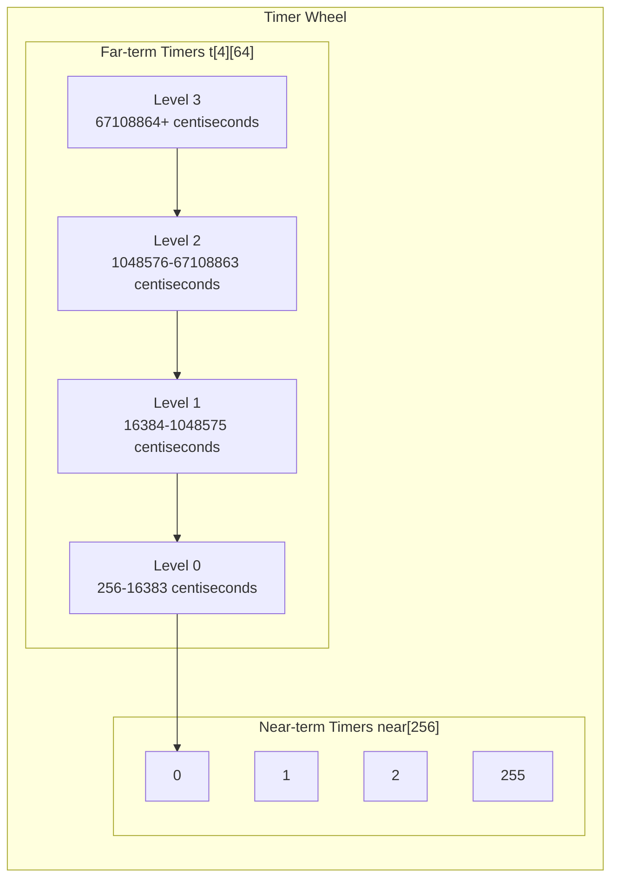
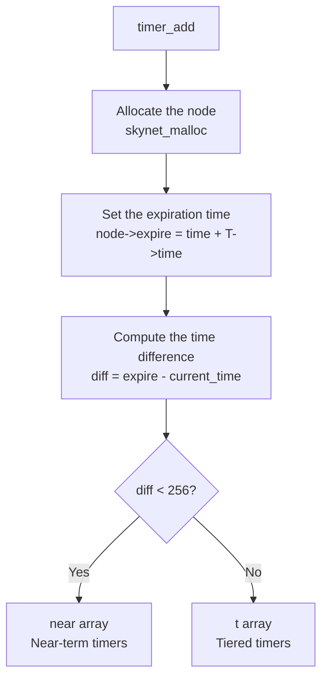
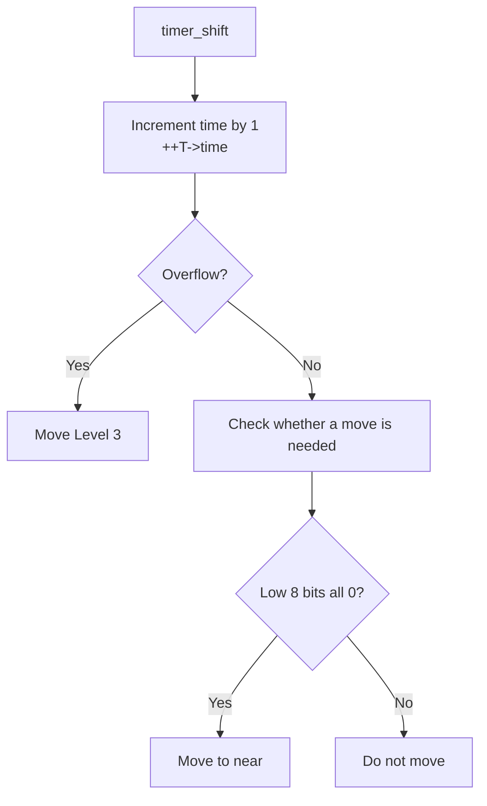

# skynet_timer.c Source Code Analysis

`skynet_timer.c` implements Skynet's timer system, based on the time-wheel algorithm. While reading the source code, we found that this module's design has an important impact on the precision and efficiency of scheduled tasks.

## File Overview

**Responsibilities**: Timer management, timeout handling

**Core Data Structures**:
- `timer` - Timer
- `timer_node` - Timer node
- `link_list` - Linked list

**Key Functions**:
- `skynet_timeout()` - Set a timeout
- `skynet_updatetime()` - Update time
- `skynet_now()` - Get the current time

## Core Data Structures

### timer - Timer

```c
struct timer {
    struct link_list near[TIME_NEAR];      // Near-term timers (0-255)
    struct link_list t[4][TIME_LEVEL];     // Far-term timers (4 levels, 64 each)
    struct spinlock lock;                  // Spinlock
    uint32_t time;                         // Current time
    uint32_t starttime;                    // Start time
    uint64_t current;                      // Current time (centiseconds)
    uint64_t current_point;                // Current time point
};
```

**Design Points**:

1. **Time-wheel Algorithm**: Uses a multi-level time wheel to manage timers
2. **Tiered Storage**: Near-term and far-term timers are stored separately
3. **Spinlock Protection**: Ensures thread safety

### timer_node - Timer Node

```c
struct timer_node {
    struct timer_node *next;  // Linked-list pointer
    uint32_t expire;          // Expiration time
};
```

### timer_event - Timer Event

```c
struct timer_event {
    uint32_t handle;  // Service handle
    int session;      // Session ID
};
```

### link_list - Linked List

```c
struct link_list {
    struct timer_node head;   // Head node
    struct timer_node *tail;  // Tail pointer
};
```

## Time-wheel Algorithm

### Time-wheel Structure



### Time Ranges

- **near**: 0 - 255 centiseconds (0 - 2.55 seconds)
- **Level 0**: 256 - 16383 centiseconds (2.56 - 163.83 seconds)
- **Level 1**: 16384 - 1048575 centiseconds (163.84 - 10485.75 seconds)
- **Level 2**: 1048576 - 67108863 centiseconds (10485.76 - 671088.63 seconds)
- **Level 3**: 67108864+ centiseconds (671088.64+ seconds)

## Timer Lifecycle

### 1. Create a Timer - timer_create_timer()

```c
static struct timer *
timer_create_timer() {
    struct timer *r = (struct timer *)skynet_malloc(sizeof(struct timer));
    memset(r, 0, sizeof(*r));
    
    int i, j;
    
    // Initialize near-term timers
    for (i = 0; i < TIME_NEAR; i++) {
        link_clear(&r->near[i]);
    }
    
    // Initialize far-term timers
    for (i = 0; i < 4; i++) {
        for (j = 0; j < TIME_LEVEL; j++) {
            link_clear(&r->t[i][j]);
        }
    }
    
    SPIN_INIT(r)
    
    r->current = 0;
    
    return r;
}
```

### 2. Initialize the Timer System - skynet_timer_init()

```c
void 
skynet_timer_init(void) {
    // Create the timer
    TI = timer_create_timer();
    
    // Get the system time
    uint32_t current = 0;
    systime(&TI->starttime, &current);
    
    // Set the current time
    TI->current = current;
    TI->current_point = gettime();
}
```

## Timer Operations

### 1. Add a Timer - timer_add()

```c
static void
timer_add(struct timer *T, void *arg, size_t sz, int time) {
    // 1. Allocate the node
    struct timer_node *node = (struct timer_node *)skynet_malloc(sizeof(*node) + sz);
    memcpy(node + 1, arg, sz);
    
    SPIN_LOCK(T);
    
    // 2. Set the expiration time
    node->expire = time + T->time;
    
    // 3. Add to the time wheel
    add_node(T, node);
    
    SPIN_UNLOCK(T);
}
```

### 2. Add a Node - add_node()

```c
static void
add_node(struct timer *T, struct timer_node *node) {
    uint32_t time = node->expire;
    uint32_t current_time = T->time;
    
    // 1. Check whether it is in the near-term range
    if ((time | TIME_NEAR_MASK) == (current_time | TIME_NEAR_MASK)) {
        // Add to the near-term timers
        link(&T->near[time & TIME_NEAR_MASK], node);
    } else {
        // 2. Check which level
        int i;
        uint32_t mask = TIME_NEAR << TIME_LEVEL_SHIFT;
        
        for (i = 0; i < 3; i++) {
            if ((time | (mask - 1)) == (current_time | (mask - 1))) {
                break;
            }
            mask <<= TIME_LEVEL_SHIFT;
        }
        
        // 3. Add to the corresponding level
        link(&T->t[i][((time >> (TIME_NEAR_SHIFT + i * TIME_LEVEL_SHIFT)) & TIME_LEVEL_MASK)], node);
    }
}
```

**Add Flow**:



### 3. Move a Node - move_list()

```c
static void
move_list(struct timer *T, int level, int idx) {
    // 1. Clear the linked list
    struct timer_node *current = link_clear(&T->t[level][idx]);
    
    // 2. Re-add all nodes
    while (current) {
        struct timer_node *temp = current->next;
        add_node(T, current);
        current = temp;
    }
}
```

### 4. Advance Time - timer_shift()

```c
static void
timer_shift(struct timer *T) {
    int mask = TIME_NEAR;
    uint32_t ct = ++T->time;
    
    if (ct == 0) {
        // Time overflow, move Level 3
        move_list(T, 3, 0);
    } else {
        uint32_t time = ct >> TIME_NEAR_SHIFT;
        int i = 0;
        
        // Check whether a move is needed
        while ((ct & (mask - 1)) == 0) {
            int idx = time & TIME_LEVEL_MASK;
            
            if (idx != 0) {
                // Move to the near-term timers
                move_list(T, i, idx);
                break;
            }
            
            mask <<= TIME_LEVEL_SHIFT;
            time >>= TIME_LEVEL_SHIFT;
            ++i;
        }
    }
}
```

**Time Advancement Flow**:



### 5. Execute Timers - timer_execute()

```c
static inline void
timer_execute(struct timer *T) {
    int idx = T->time & TIME_NEAR_MASK;
    
    // Process all expired timers
    while (T->near[idx].head.next) {
        struct timer_node *current = link_clear(&T->near[idx]);
        SPIN_UNLOCK(T);
        
        // Dispatch the messages (no lock needed)
        dispatch_list(current);
        
        SPIN_LOCK(T);
    }
}
```

### 6. Dispatch Messages - dispatch_list()

```c
static inline void
dispatch_list(struct timer_node *current) {
    do {
        // 1. Get the event
        struct timer_event * event = (struct timer_event *)(current + 1);
        
        // 2. Build the message
        struct skynet_message message;
        message.source = 0;
        message.session = event->session;
        message.data = NULL;
        message.sz = (size_t)PTYPE_RESPONSE << MESSAGE_TYPE_SHIFT;
        
        // 3. Push into the message queue
        skynet_context_push(event->handle, &message);
        
        // 4. Free the node
        struct timer_node * temp = current;
        current = current->next;
        skynet_free(temp);
    } while (current);
}
```

### 7. Update the Timer - timer_update()

```c
static void 
timer_update(struct timer *T) {
    SPIN_LOCK(T);
    
    // 1. Execute timers with a timeout of 0
    timer_execute(T);
    
    // 2. Advance time
    timer_shift(T);
    
    // 3. Execute expired timers
    timer_execute(T);
    
    SPIN_UNLOCK(T);
}
```

## Public Interface

### 1. Set a Timeout - skynet_timeout()

```c
int
skynet_timeout(uint32_t handle, int time, int session) {
    if (time <= 0) {
        // Send the message immediately
        struct skynet_message message;
        message.source = 0;
        message.session = session;
        message.data = NULL;
        message.sz = (size_t)PTYPE_RESPONSE << MESSAGE_TYPE_SHIFT;
        
        if (skynet_context_push(handle, &message)) {
            return -1;
        }
    } else {
        // Add a timer
        struct timer_event event;
        event.handle = handle;
        event.session = session;
        timer_add(TI, &event, sizeof(event), time);
    }
    
    return session;
}
```

### 2. Update Time - skynet_updatetime()

```c
void
skynet_updatetime(void) {
    uint64_t cp = gettime();
    
    if (cp < TI->current_point) {
        // Time rollback error
        skynet_error(NULL, "time diff error: change from %lld to %lld", cp, TI->current_point);
        TI->current_point = cp;
    } else if (cp != TI->current_point) {
        // Compute the time difference
        uint32_t diff = (uint32_t)(cp - TI->current_point);
        TI->current_point = cp;
        TI->current += diff;
        
        // Update the timers
        int i;
        for (i = 0; i < diff; i++) {
            timer_update(TI);
        }
    }
}
```

### 3. Get the Current Time - skynet_now()

```c
uint64_t 
skynet_now(void) {
    return TI->current;
}
```

### 4. Get the Start Time - skynet_starttime()

```c
uint32_t
skynet_starttime(void) {
    return TI->starttime;
}
```

## Time Retrieval

### System Time - systime()

```c
static void
systime(uint32_t *sec, uint32_t *cs) {
    struct timespec ti;
    clock_gettime(CLOCK_REALTIME, ti);
    *sec = (uint32_t)ti.tv_sec;
    *cs = (uint32_t)(ti.tv_nsec / 10000000);  // Convert to centiseconds
}
```

### Monotonic Time - gettime()

```c
static uint64_t
gettime() {
    uint64_t t;
    struct timespec ti;
    clock_gettime(CLOCK_MONOTONIC, ti);
    t = (uint64_t)ti.tv_sec * 100;  // Convert to centiseconds
    t += ti.tv_nsec / 10000000;
    return t;
}
```

### Thread Time - skynet_thread_time()

```c
uint64_t
skynet_thread_time(void) {
    struct timespec ti;
    clock_gettime(CLOCK_THREAD_CPUTIME_ID, ti);
    
    return (uint64_t)ti.tv_sec * MICROSEC + (uint64_t)ti.tv_nsec / (NANOSEC / MICROSEC);
}
```

## Linked List Operations

### Clear the Linked List - link_clear()

```c
static inline struct timer_node *
link_clear(struct link_list *list) {
    struct timer_node * ret = list->head.next;
    list->head.next = 0;
    list->tail = &(list->head);
    
    return ret;
}
```

### Add a Node - link()

```c
static inline void
link(struct link_list *list, struct timer_node *node) {
    list->tail->next = node;
    list->tail = node;
    node->next = 0;
}
```

## Thread Safety

### Spinlock Usage

```c
SPIN_LOCK(T);
// ... critical-section operations ...
SPIN_UNLOCK(T);
```

### Lock Separation

```c
// In timer_execute, release the lock when dispatching messages
while (T->near[idx].head.next) {
    struct timer_node *current = link_clear(&T->near[idx]);
    SPIN_UNLOCK(T);  // Release the lock
    
    dispatch_list(current);  // Dispatch the messages
    
    SPIN_LOCK(T);  // Re-acquire the lock
}
```

## Performance Optimizations

### 1. Batch Processing

```c
// Process multiple time units at once
for (i = 0; i < diff; i++) {
    timer_update(TI);
}
```

### 2. Lock Separation

Release the lock when dispatching messages to reduce lock contention.

### 3. Cache Friendly

Linked-list nodes are allocated contiguously to improve the cache hit rate.

## Design Patterns

### 1. Time-wheel Algorithm

```
Time-wheel characteristics:
- O(1) timer addition
- O(1) time advancement
- Tiered storage reduces memory usage
```

### 2. Linked-list Queue

```
Linked-list characteristics:
- Dynamic size
- O(1) head insertion
- O(1) tail append
```

### 3. Producer-Consumer

```
The timer as producer:
    skynet_timeout() -> add a timer
    timer_update() -> dispatch messages

The service as consumer:
    Receive timeout messages
```

## Interaction with Other Modules

### Interaction with skynet_server.c

```c
// Set a timeout
skynet_timeout(handle, time, session);

// Push a message
skynet_context_push(handle, &message);
```

### Interaction with skynet_start.c

```c
// Initialize the timer
skynet_timer_init();

// Update the time periodically
skynet_updatetime();
```

## Key Design Decisions

### 1. Why Use a Time Wheel?

- **Efficient**: O(1) addition and advancement
- **Low Memory**: Tiered storage reduces memory usage
- **Simple**: Simple implementation, easy to understand

### 2. Why Use Centiseconds?

- **Sufficient Precision**: Game timers usually do not need millisecond-level precision
- **Reduced Update Frequency**: Update once every 10 milliseconds
- **Reduced CPU Usage**: Lower the overhead of timer updates

### 3. Why Use a Spinlock?

- **Low Latency**: Timer operations are very fast
- **Avoid Context Switches**: Reduce thread-switching overhead
- **Simple**: Simple implementation, easy to understand

## Common Questions

### 1. What to Do About a Time Rollback?

Record an error and continue running.

### 2. What to Do About Timer Overflow?

The time wraps back to 0 and the Level 3 nodes are moved.

### 3. How Is Precision Guaranteed?

By using monotonic time to avoid the effects of system time adjustments.

## Next Steps

- [socket_server.c Analysis](/analysis/socket-server) - Network I/O implementation
- [skynet_start.c Analysis](/analysis/skynet-start) - System startup implementation
- [Timer System](/architecture/timer-system) - Timer design principles
