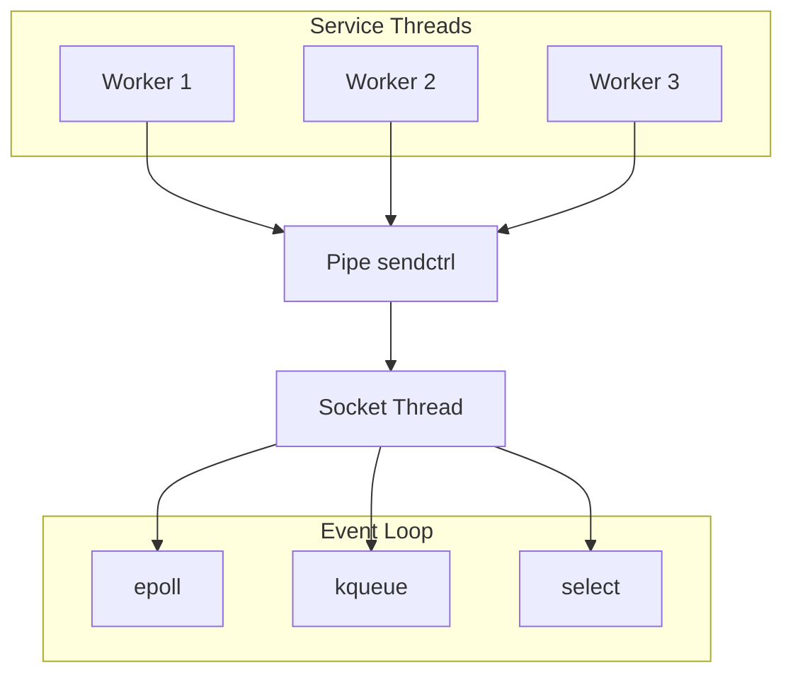
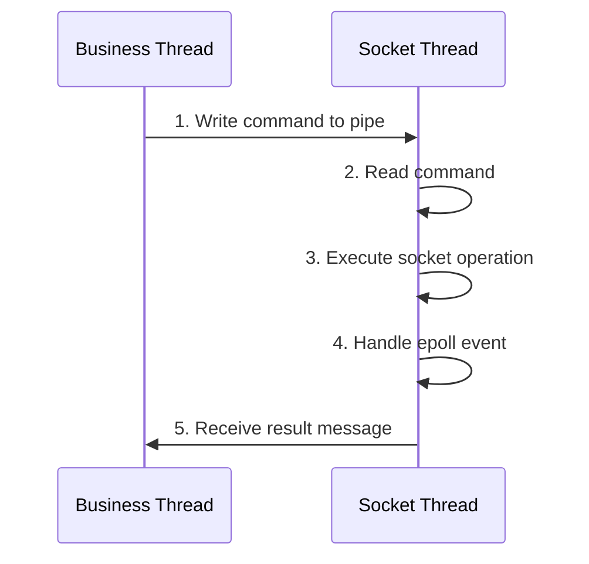
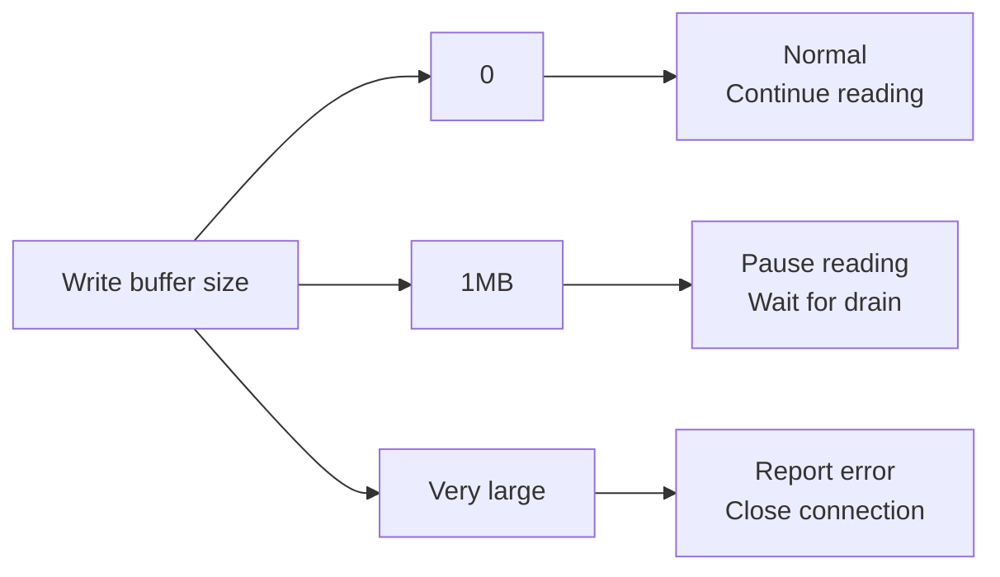
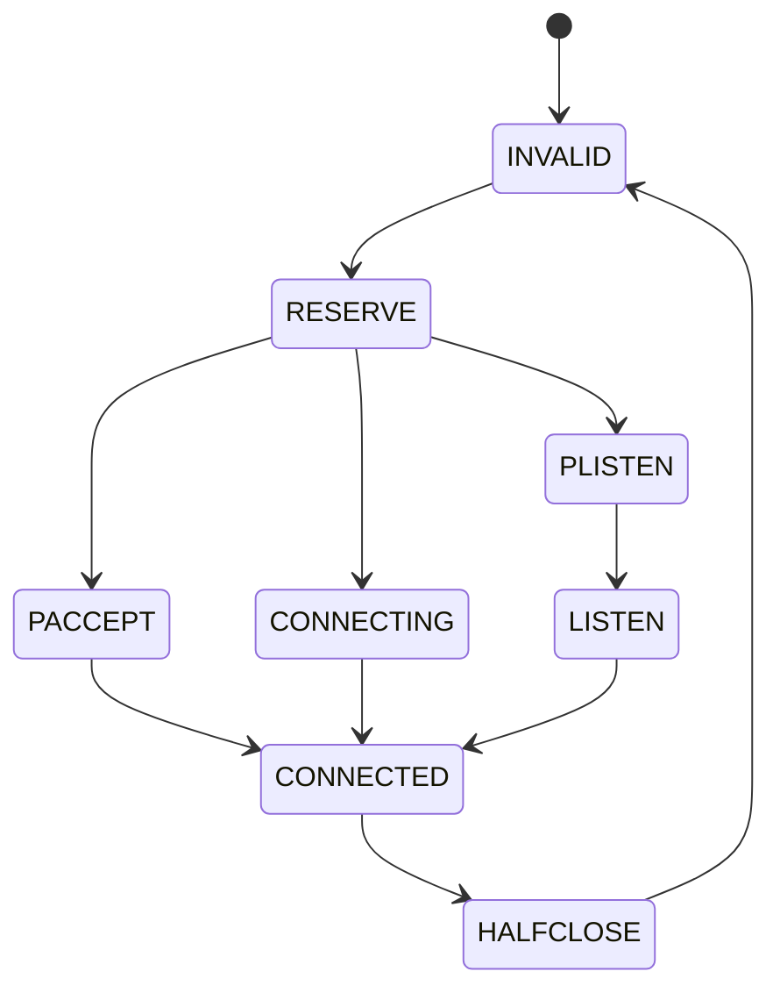

# socket_server.c Source Code Analysis

Network I/O is one of Skynet's core capabilities. `socket_server.c` wraps the underlying socket operations and provides a unified asynchronous network interface. In real projects, the design of this module directly affects the server's concurrency capacity and latency performance.

## Overall Architecture

From a practical usage perspective, socket_server.c solves several core problems:

1. **Unified asynchronous I/O**: wraps epoll/kqueue/select, shielding platform differences
2. **Thread safety**: socket operations run in a dedicated thread, communicating with the main thread via pipes
3. **Memory management**: write buffer management and flow control
4. **Protocol support**: unified TCP/UDP abstraction



## Core Data Structures

### socket - Connection Object

```c
struct socket {
    uintptr_t opaque;           // Associated service handle
    struct wb_list high;        // High priority write buffer
    struct wb_list low;         // Low priority write buffer
    int64_t wb_size;           // Total write buffer size
    struct socket_stat stat;   // Statistics
    ATOM_ULONG sending;        // Bytes in flight
    int fd;                    // File descriptor
    int id;                    // socket ID (with version)
    ATOM_INT type;             // socket type
    uint8_t protocol;          // TCP/UDP
    bool reading;              // Whether reading
    bool writing;              // Whether writing
    bool closing;              // Whether closing
    // ...
};
```

**Design notes:**

- **Dual buffer queues**: high/low priority separation, avoiding large messages blocking control messages
- **Atomic types**: type and sending use atomic operations, reducing lock contention
- **Versioned ID**: the high bits of the socket ID carry a version number, avoiding the ABA problem

### socket_server - Server Instance

```c
struct socket_server {
    volatile uint64_t time;    // Current time
    int reserve_fd;            // Reserved fd (for handling EMFILE)
    int recvctrl_fd;           // Pipe read end
    int sendctrl_fd;           // Pipe write end
    poll_fd event_fd;          // epoll/kqueue fd
    ATOM_INT alloc_id;         // ID allocator
    struct socket slot[MAX_SOCKET]; // socket pool
    struct event ev[MAX_EVENT];     // Event array
    // ...
};
```

**Design notes:**

- **Reserved fd**: when system fds are exhausted, close the reserved fd before retrying accept
- **Fixed-size socket pool**: avoids dynamic allocation, O(1) lookup
- **Pipe communication**: the socket thread and main thread pass commands via pipes

### write_buffer - Write Buffer

```c
struct write_buffer {
    struct write_buffer *next;
    const void *buffer;
    char *ptr;
    size_t sz;
    bool userobject;
};
```

## Thread Model

Skynet's network I/O runs in a dedicated thread, separated from the business threads. This design prevents network I/O from blocking business logic.

### Communication Mechanism



### Command Protocol

Command types passed through the pipe:

```c
// Command types
'R'  // Resume - resume socket
'S'  // Pause - pause socket
'B'  // Bind - bind fd
'L'  // Listen - listen
'K'  // Close - close
'O'  // Open - connect
'W'  // Write - enable write
'D'  // Send high - high priority send
'P'  // Send low - low priority send
'A'  // UDP send
'T'  // Setopt - set options
'U'  // UDP create
```

## Core Flows

### 1. Creating socket_server

```c
struct socket_server * 
socket_server_create(uint64_t time) {
    // Create epoll/kqueue
    poll_fd efd = sp_create();
    
    // Create pipe
    int fd[2];
    pipe(fd);
    
    // Add pipe read end to epoll
    sp_add(efd, fd[0], NULL);
    
    // Allocate structure
    struct socket_server *ss = MALLOC(sizeof(*ss));
    ss->event_fd = efd;
    ss->recvctrl_fd = fd[0];
    ss->sendctrl_fd = fd[1];
    ss->reserve_fd = dup(1);  // Reserved fd
    
    // Initialize socket pool
    for (i = 0; i < MAX_SOCKET; i++) {
        struct socket *s = &ss->slot[i];
        ATOM_INIT(&s->type, SOCKET_TYPE_INVALID);
        // ...
    }
    
    return ss;
}
```

**Summary:**

- The reserved fd is to handle `EMFILE` errors (fd exhaustion)
- Pipes are used for inter-thread communication, more efficient than mutex + condition variable

### 2. Main loop - socket_server_poll

```c
int
socket_server_poll(struct socket_server *ss, struct socket_message *result, int *more) {
    for (;;) {
        // 1. Check pipe commands
        if (ss->checkctrl) {
            if (has_cmd(ss)) {
                int type = ctrl_cmd(ss, result);
                if (type != -1) {
                    return type;
                }
            }
        }
        
        // 2. Handle epoll events
        if (ss->event_index == ss->event_n) {
            ss->event_n = sp_wait(ss->event_fd, ss->ev, MAX_EVENT);
            ss->event_index = 0;
        }
        
        // 3. Dispatch event
        struct event *e = &ss->ev[ss->event_index++];
        struct socket *s = e->s;
        
        switch (ATOM_LOAD(&s->type)) {
        case SOCKET_TYPE_CONNECTING:
            return report_connect(ss, s, &l, result);
        case SOCKET_TYPE_LISTEN:
            return report_accept(ss, s, result);
        default:
            if (e->read) {
                return forward_message_tcp(ss, s, &l, result);
            }
            if (e->write) {
                return send_buffer(ss, s, &l, result);
            }
        }
    }
}
```

**Summary:**

- Commands take priority over event handling, ensuring control commands are responded to promptly
- Events are handled in batches (MAX_EVENT=64), reducing epoll_wait calls
- `SOCKET_MORE` indicates more data has not been fully read and reading should continue

### 3. Sending data

```c
int
socket_server_send(struct socket_server *ss, struct socket_sendbuffer *buf) {
    struct socket *s = &ss->slot[HASH_ID(buf->id)];
    
    // Check socket validity
    if (socket_invalid(s, buf->id)) {
        free_buffer(ss, buf);
        return -1;
    }
    
    // Data already being sent, add to queue
    if (s->wb_size > 0) {
        append_sendbuffer(ss, s, buf);
        return 0;
    }
    
    // Try direct send
    int n = write(s->fd, buf->buffer, buf->sz);
    if (n < 0) {
        // EAGAIN: add to queue, wait until writable
        append_sendbuffer(ss, s, buf);
        sp_write(ss, s->fd, s, true);
        return 0;
    }
    
    if (n == buf->sz) {
        // Fully sent
        return 0;
    }
    
    // Partially sent, enqueue the remainder
    append_sendbuffer_tail(ss, s, buf, n);
    sp_write(ss, s->fd, s, true);
    return 0;
}
```

**Summary:**

- Prefer attempting a direct send to reduce system calls
- When `wb_size` exceeds the threshold, backpressure is triggered (reading is paused)
- The write buffer uses a linked list, supporting partial sends

### 4. Receiving data

```c
static int
forward_message_tcp(struct socket_server *ss, struct socket *s, struct socket_lock *l, struct socket_message *result) {
    int sz = s->p.size;
    char *buffer;
    
    if (sz == 0) {
        sz = MIN_READ_BUFFER;
    }
    
    buffer = MALLOC(sz);
    int n = read(s->fd, buffer, sz);
    
    if (n < 0) {
        FREE(buffer);
        if (errno == EAGAIN) {
            return -1;
        }
        return report_error(s, result, strerror(errno));
    }
    
    if (n == 0) {
        FREE(buffer);
        return report_close(s, result);
    }
    
    // Dynamically adjust buffer size
    if (n == sz) {
        s->p.size = sz * 2;
    } else if (sz > MIN_READ_BUFFER && n * 2 < sz) {
        s->p.size = sz / 2;
    }
    
    result->opaque = s->opaque;
    result->id = s->id;
    result->ud = n;
    result->data = buffer;
    
    return SOCKET_DATA;
}
```

**Summary:**

- The buffer is dynamically adjusted: grow if read to full, shrink if less was read
- The minimum buffer is 64 bytes, avoiding frequent allocations
- Returning `SOCKET_MORE` indicates more data remains, triggering continued reading

## Flow Control

### Write Buffer Watermark

```c
#define WARNING_SIZE (1024*1024)  // 1MB

// Check whether reading should be paused
if (s->wb_size >= WARNING_SIZE) {
    // Pause reading, wait for the write buffer to drain
    sp_read(ss, s->fd, s, false);
    s->reading = false;
}
```

### Backpressure Mechanism



**Summary:**

- Backpressure is implemented by pausing reading, not by dropping data
- The 1MB threshold is an empirical value, adjustable based on the workload
- Reading resumes automatically after the write buffer drains

## socket Type State Machine



### Meaning of Each State

| State | Meaning |
|------|------|
| INVALID | Invalid, unused |
| RESERVE | ID allocated, fd not yet bound |
| PLISTEN | Preparing to listen |
| LISTEN | Listening |
| CONNECTING | Connecting |
| CONNECTED | Connected |
| HALFCLOSE_READ | Half-closed (read) |
| HALFCLOSE_WRITE | Half-closed (write) |
| PACCEPT | Passive accept |
| BIND | Binding an external fd |

## Event Handling

### epoll Event Mapping

```c
// socket_poll.h (Linux)
struct event {
    struct socket *s;
    bool read;
    bool write;
    bool error;
    bool eof;
};

// Mapped from epoll_event
static void
sp_epoll_event(struct event *e, struct epoll_event *ee) {
    e->read = (ee->events & EPOLLIN) != 0;
    e->write = (ee->events & EPOLLOUT) != 0;
    e->error = (ee->events & EPOLLERR) != 0;
    e->eof = (ee->events & EPOLLHUP) != 0;
}
```

### Event Priority

```
Processing order:
1. Pipe commands (highest priority)
2. Connection events (CONNECTING/CONNECTED)
3. Read events
4. Write events
5. Error events
6. EOF events
```

## UDP Support

### UDP socket creation

```c
static int
udp_socket(struct socket_server *ss, struct request_udp *udp, struct socket_message *result) {
    int fd = socket(udp->family, SOCK_DGRAM, 0);
    
    // Bind to epoll
    sp_add(ss->event_fd, fd, s);
    
    // Initialize socket
    s->fd = fd;
    s->protocol = PROTOCOL_UDP;
    s->type = SOCKET_TYPE_CONNECTED;
    
    return SOCKET_UDP;
}
```

### UDP send

```c
static int
send_socket_udp(struct socket_server *ss, struct socket *s, struct write_buffer_udp *wu, struct socket_message *result) {
    union sockaddr_all sa;
    
    // Parse address
    if (udp_socket_address(s, wu, &sa)) {
        int n = sendto(s->fd, wu->buffer.buffer, wu->buffer.sz, 0, &sa.s, sizeof(sa));
        // ...
    }
}
```

## Error Handling

### EMFILE handling

```c
static int
report_accept(struct socket_server *ss, struct socket *s, struct socket_message *result) {
    int fd = accept(s->fd, ...);
    
    if (fd < 0) {
        if (errno == EMFILE) {
            // fds exhausted, close reserved fd and retry
            close(ss->reserve_fd);
            fd = accept(s->fd, ...);
            ss->reserve_fd = dup(1);
        }
        // ...
    }
}
```

**Summary:**

- `EMFILE` is a common production issue, and the reserved fd is the standard mitigation
- Set non-blocking immediately after accept to avoid blocking the socket thread

### Connection errors

```c
static int
report_connect(struct socket_server *ss, struct socket *s, struct socket_lock *l, struct socket_message *result) {
    int error;
    socklen_t len = sizeof(error);
    int code = getsockopt(s->fd, SOL_SOCKET, SO_ERROR, &error, &len);
    
    if (code < 0 || error) {
        return report_error(s, result, strerror(error));
    }
    
    // Connection succeeded
    s->type = SOCKET_TYPE_CONNECTED;
    return SOCKET_OPEN;
}
```

## Performance Optimizations

### 1. Batch event handling

```c
#define MAX_EVENT 64

// A single epoll_wait returns at most 64 events
ss->event_n = sp_wait(ss->event_fd, ss->ev, MAX_EVENT);
```

### 2. Deferred close

```c
// Do not close immediately, mark as closing
s->closing = true;

// Wait for the write buffer to drain before closing
if (s->wb_size == 0) {
    force_close(ss, s, l, result);
}
```

### 3. Zero-copy send

```c
// The SOCKET_BUFFER_OBJECT type supports zero-copy
if (sz == USEROBJECT) {
    // Use the user object's free_func
    so->free_func = ss->soi.free;
}
```

## Relationship with skynet_socket.c

`socket_server.c` is the low-level implementation, and `skynet_socket.c` is the higher-level wrapper:

```c
// skynet_socket.c
void 
skynet_socket_start(struct skynet_context *ctx, int id) {
    struct request_package request;
    int len = start_socket(ss, &request, id, (uintptr_t)ctx);
    send_request(ss, &request, 'S', len);
}
```

**Summary:**

- `skynet_socket.c` handles interaction with services
- `socket_server.c` handles low-level I/O
- The two layers are separated with clear responsibilities

## FAQ

### 1. Why use a pipe instead of a shared queue?

Pipes natively support epoll watching and require no extra wakeup mechanism.

### 2. Why is the socket pool a fixed size?

It avoids dynamic allocation, allows O(1) lookup, and MAX_SOCKET=65536 is sufficient for most scenarios.

### 3. How to handle a large number of concurrent connections?

epoll + non-blocking I/O + event-driven design lets a single thread handle tens of thousands of connections.

## Next Steps

- [socket module](/analysis/socket-lua) - higher-level wrapper
- [Network I/O design](/architecture/network-io) - architecture design
- [Gate service](/analysis/gate-service) - gateway implementation
