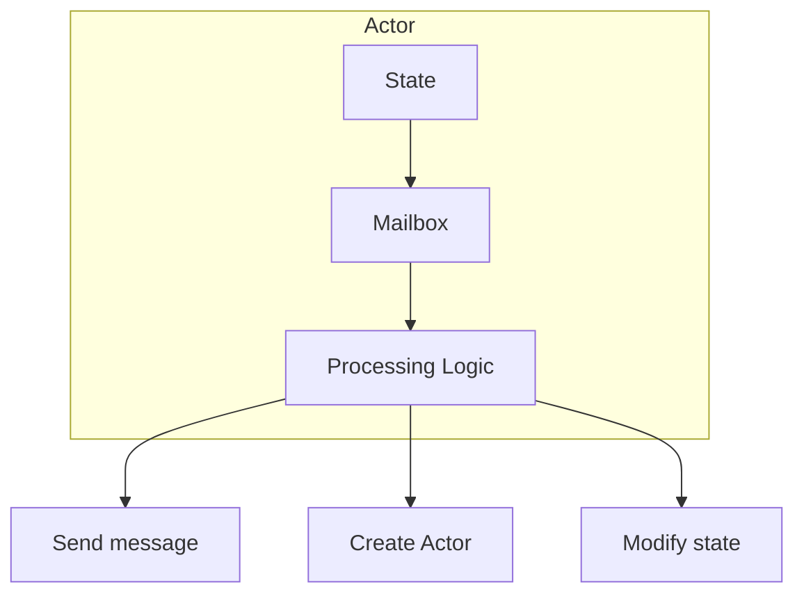

# Actor Model

The Actor model is Skynet's core design paradigm. In real projects, we have found that understanding this model is essential for using Skynet correctly.

## What Is the Actor Model

The Actor model is a model of concurrent computation proposed by Carl Hewitt in 1973. From a practical application point of view, its core ideas are:

- An **Actor** is the basic unit of computation; every Actor runs independently
- Every Actor owns private state that is not shared with other Actors
- Actors communicate through message passing, avoiding the complexity of locks
- Every Actor processes one message at a time, which guarantees thread safety

### Actor Behavior

An Actor can perform the following operations:

1. **Send messages**: send messages to other Actors
2. **Create Actors**: create new Actors
3. **Change state**: modify its own private state
4. **Designate behavior**: decide how to handle the next message



## Actor Implementation in Skynet

### A Service Is an Actor

In Skynet, every **Service** is an Actor:

```c
struct skynet_context {
    void *instance;           // Actor instance (state)
    struct skynet_module *mod; // Actor type
    struct message_queue *queue; // Actor mailbox
    skynet_cb cb;             // Actor behavior (message handler)
    // ...
};
```

### Message Passing

Actors send messages to each other via `skynet_send()`:

```c
int skynet_send(
    struct skynet_context *context,  // Sender
    uint32_t source,                // Source address
    uint32_t destination,           // Destination address
    int type,                       // Message type
    int session,                    // Session ID
    void *data,                     // Message data
    size_t size                     // Message size
);
```

### Message Processing

Every Actor processes messages through a callback function:

```c
typedef int (*skynet_cb)(
    struct skynet_context *ctx,  // Actor context
    void *ud,                    // User data
    int type,                    // Message type
    int session,                 // Session ID
    uint32_t source,             // Message source
    const void *msg,             // Message content
    size_t sz                    // Message size
);
```

## Actors in Lua

### Creating an Actor

```lua
local skynet = require "skynet"

-- Create a new Actor (service)
local actor = skynet.newservice("my_actor")
```

### Defining Actor Behavior

```lua
-- my_actor.lua
local skynet = require "skynet"

-- The Actor's state
local state = {
    count = 0,
    data = {}
}

-- The Actor's message handler
skynet.start(function()
    skynet.dispatch("lua", function(session, address, cmd, ...)
        if cmd == "add" then
            state.count = state.count + 1
            skynet.ret(skynet.pack(state.count))
        elseif cmd == "get" then
            skynet.ret(skynet.pack(state.count))
        elseif cmd == "set" then
            local key, value = ...
            state.data[key] = value
            skynet.ret(skynet.pack(true))
        end
    end)
end)
```

### Communicating with an Actor

```lua
-- Send a message and wait for a reply
local count = skynet.call(actor, "lua", "add")
local value = skynet.call(actor, "lua", "get")

-- One-way send (no reply expected)
skynet.send(actor, "lua", "set", "key", "value")
```

## Advantages of the Actor Model

### 1. Avoiding Shared State

In traditional multithreaded programming, multiple threads accessing shared data must take a lock:

```c
// Traditional approach: a lock is required
pthread_mutex_lock(&mutex);
shared_data++;
pthread_mutex_unlock(&mutex);

// Actor approach: no lock needed
skynet.send(actor, "lua", "increment")
```

### 2. Natural Concurrency

Every Actor runs independently and can process messages in parallel:

```mermaid
gantt
    title Concurrent Actor execution
    dateFormat X
    axisFormat %s
    
    section Actor A
    Process message 1 :a1, 0, 100
    Process message 2 :a2, 100, 200
    Process message 3 :a3, 200, 300
    
    section Actor B
    Process message 1 :b1, 0, 100
    Process message 2 :b2, 100, 200
    Process message 3 :b3, 200, 300
    
    section Actor C
    Process message 1 :c1, 0, 100
    Process message 2 :c2, 100, 200
    Process message 3 :c3, 200, 300
```



### 3. Easy to Understand and Test

An Actor's behavior is determined entirely by its message-handling logic and has no side effects, which makes it easy to test:

```lua
-- Test an Actor
function test_actor()
    local actor = skynet.newservice("test_actor")
    
    -- Send messages and verify the results
    local result = skynet.call(actor, "lua", "add")
    assert(result == 1, "Expected 1, got " .. result)
    
    local result = skynet.call(actor, "lua", "add")
    assert(result == 2, "Expected 2, got " .. result)
end
```

## Application Scenarios of the Actor Pattern

### 1. Game Entities

Every game entity (player, NPC, monster) can be an Actor:

```lua
-- player.lua
local skynet = require "skynet"

local player = {
    id = nil,
    name = nil,
    hp = 100,
    position = {x = 0, y = 0, z = 0}
}

skynet.start(function()
    skynet.dispatch("lua", function(session, address, cmd, ...)
        if cmd == "move" then
            local x, y, z = ...
            player.position = {x = x, y = y, z = z}
            -- Broadcast to nearby players
            broadcast_nearby("player_move", player.id, x, y, z)
        elseif cmd == "attack" then
            local target_id = ...
            -- Handle attack logic
        end
    end)
end)
```

### 2. Manager Services

All kinds of managers can be implemented as Actors:

```lua
-- room_manager.lua
local skynet = require "skynet"

local rooms = {}

skynet.start(function()
    skynet.dispatch("lua", function(session, address, cmd, ...)
        if cmd == "create_room" then
            local room_id = create_room(...)
            skynet.ret(skynet.pack(room_id))
        elseif cmd == "join_room" then
            local room_id, player_id = ...
            join_room(room_id, player_id)
        end
    end)
end)
```

### 3. Gateway Service

The gateway can be an Actor that handles client connections:

```lua
-- gate.lua
local skynet = require "skynet"
local socket = require "skynet.socket"

local connections = {}

skynet.start(function()
    skynet.dispatch("lua", function(session, address, cmd, ...)
        if cmd == "new_connection" then
            local fd = ...
            handle_new_connection(fd)
        elseif cmd == "disconnect" then
            local fd = ...
            handle_disconnect(fd)
        end
    end)
end)
```

## Comparison with Other Concurrency Models

| Feature | Actor Model | Thread Model | Coroutine Model |
|------|-----------|---------|---------|
| Shared state | None | Yes | Limited |
| Lock requirements | None | Required | Depends |
| Concurrency granularity | Message level | Thread level | Coroutine level |
| Scheduling | Message-driven | Preemptive | Cooperative |
| Use cases | Games, chat | General purpose | IO-intensive |

## Best Practices

### 1. Single Responsibility

Every Actor should be responsible for exactly one thing:

```lua
-- Good: single responsibility
local player_actor = {}      -- Only handles player logic
local inventory_actor = {}   -- Only handles inventory logic
local quest_actor = {}       -- Only handles quest logic

-- Bad: mixed responsibilities
local god_actor = {}         -- Handles all logic
```

### 2. Message Design

Messages should be concise and clear:

```lua
-- Good: explicit messages
skynet.call(actor, "lua", "get_player_info", player_id)
skynet.call(actor, "lua", "update_hp", player_id, new_hp)

-- Bad: ambiguous messages
skynet.call(actor, "lua", "do_something", "player", player_id, "hp", new_hp)
```

### 3. Error Handling

Actors should handle errors gracefully:

```lua
skynet.dispatch("lua", function(session, address, cmd, ...)
    local ok, result = pcall(function()
        return handle_command(cmd, ...)
    end)
    
    if ok then
        skynet.ret(skynet.pack(result))
    else
        skynet.ret(skynet.pack(nil, result))  -- Return the error message
    end
end)
```

## Next Steps

- [Message-Driven Design](/architecture/message-driven) - Understand the message system in depth
- [Services and Modules](/architecture/service-module) - Creating and managing services
- [skynet_server.c Analysis](/analysis/skynet-server) - Actor implementation at the source code level
