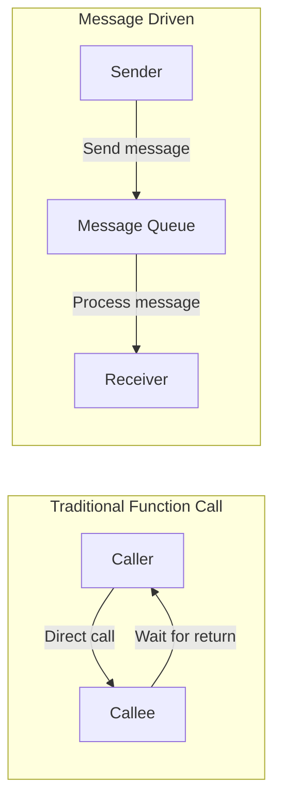
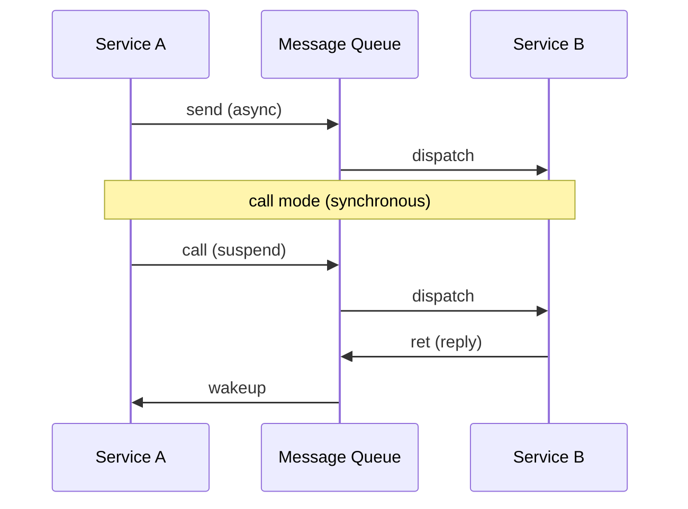
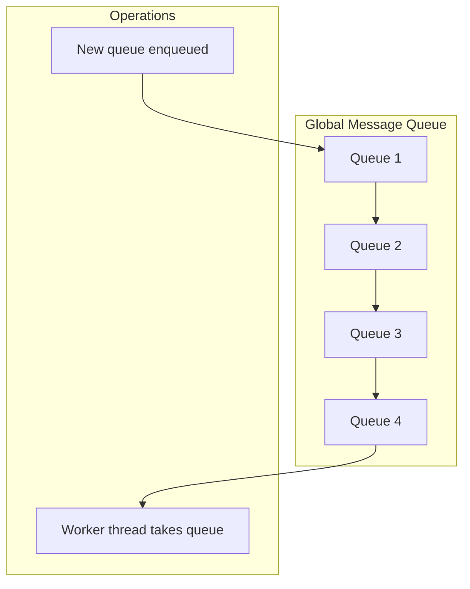
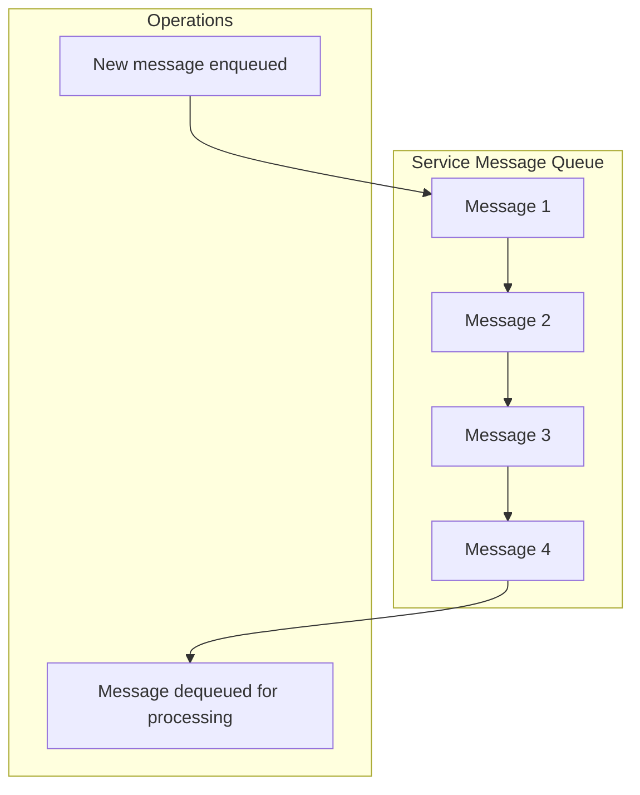

# Message-Driven Design

Message-driven design is one of Skynet's core design philosophies. Across multiple project practices, we have found that understanding the message system is the key to using Skynet correctly.

## The Concept of Message-Driven Design

In a message-driven architecture, there are several core characteristics:

- **Everything is a message**: all interactions are done through messages, including inter-service communication, timers, network events, etc.
- **Asynchronous processing**: a message send returns immediately without waiting for processing to complete, which improves the system's concurrency
- **Event loop**: the system continuously takes messages from the message queue and processes them; this is the foundation of Skynet's operation

### Message-Driven vs Function Call



## The Skynet Message System

### Message Structure

```c
struct skynet_message {
    uint32_t source;    // Message source (service handle)
    int session;        // Session ID
    void *data;         // Message data
    size_t sz;          // Message size
};
```

### Message Types

Skynet supports multiple message types:

```lua
-- Message type constants
local PTYPE_TEXT = 0      -- Text message
local PTYPE_RESPONSE = 1  -- Response message
local PTYPE_ERROR = 2     -- Error message
local PTYPE_LUA = 3       -- Lua message
local PTYPE_SNAP = 4      -- Snapshot message
```

### Message Flow



## Core Message Operations

### 1. Sending Messages (skynet.send)

One-way message sending that does not wait for a reply:

```lua
local skynet = require "skynet"

-- Send a message
skynet.send(target, type, ...)
```

**Characteristics**:
- Asynchronous operation, returns immediately
- Does not guarantee the message is processed
- Suitable for scenarios such as notifications and broadcasts

**Example**:
```lua
-- Notify all online players
for _, player in pairs(online_players) do
    skynet.send(player.address, "lua", "server_announcement", message)
end
```

### 2. Calling Messages (skynet.call)

Send a message and wait for the reply:

```lua
local skynet = require "skynet"

-- Send a message and wait for the reply
local result = skynet.call(target, type, ...)
```

**Characteristics**:
- Synchronous operation (actually a coroutine suspension)
- Waits for the target to finish processing and return the result
- Suitable for scenarios such as queries and requests

**Example**:
```lua
-- Query player information
local player_info = skynet.call(player_service, "lua", "get_info", player_id)

-- Call the database service
local data = skynet.call(db_service, "lua", "query", sql)
```

### 3. Responding to Messages (skynet.ret)

Reply to the caller's message:

```lua
local skynet = require "skynet"

skynet.dispatch("lua", function(session, address, cmd, ...)
    -- Process the message
    local result = process(cmd, ...)
    
    -- Return the result
    skynet.ret(skynet.pack(result))
end)
```

**Characteristics**:
- Must be used inside a skynet.dispatch callback
- Uses skynet.pack to pack the return values
- Automatically sets the session to match the request

### 4. Ignoring Responses (skynet.response)

For messages that do not need a reply:

```lua
skynet.dispatch("lua", function(session, address, cmd, ...)
    if cmd == "fire_and_forget" then
        -- Ignore the response
        skynet.response()
        return
    end
    
    -- Normal processing
    skynet.ret(skynet.pack(result))
end)
```

## Message Queue Mechanism

### Global Message Queue



**Lessons learned**:
- The global queue is a linked-list structure that supports fast enqueue and dequeue
- Worker threads take service queues from the head of the queue
- When a new message arrives, the service queue is enqueued from the tail

### Service Message Queue



**Lessons learned**:
- Each service has its own independent message queue
- Messages are processed in FIFO order
- When the queue is empty, the service goes to sleep

### Message Scheduling Flow

```c
// Key functions in skynet_mq.c

// Message enqueue
void skynet_mq_push(struct message_queue *q, struct skynet_message *message) {
    spinlock_lock(&q->lock);
    
    // Check whether the queue is full
    if (q->in_global == 0) {
        // Add the queue to the global queue
        globalmq_push(q);
        q->in_global = 1;
    }
    
    // Put the message into the queue
    q->queue[q->tail] = *message;
    q->tail = (q->tail + 1) % q->cap;
    
    spinlock_unlock(&q->lock);
}

// Message dequeue
int skynet_mq_pop(struct message_queue *q, struct skynet_message *message) {
    spinlock_lock(&q->lock);
    
    if (q->head == q->tail) {
        // The queue is empty
        q->in_global = 0;
        spinlock_unlock(&q->lock);
        return 0;
    }
    
    // Take out the message
    *message = q->queue[q->head];
    q->head = (q->head + 1) % q->cap;
    
    spinlock_unlock(&q->lock);
    return 1;
}
```

## Message Processing Flow

### Worker Threads Processing Messages

```c
// Worker thread in skynet_start.c

static void *thread_worker(void *p) {
    struct worker_parm *wp = p;
    int id = wp->id;
    
    while (!skynet_context_total()) {
        // Take a message queue from the global queue
        struct message_queue *q = globalmq_pop();
        
        if (q) {
            // Process the messages in the queue
            struct skynet_message msg;
            if (skynet_mq_pop(q, &msg)) {
                // Find the corresponding service and process the message
                struct skynet_context *ctx = skynet_handle_grab(msg.source);
                if (ctx) {
                    ctx->cb(ctx, ctx->cb_ud, msg.type, msg.session, 
                           msg.source, msg.data, msg.sz);
                    skynet_context_release(ctx);
                }
            }
        }
    }
    
    return NULL;
}
```

### Lua Layer Message Processing

```lua
-- Message processing in skynet.lua

function skynet.dispatch(type, func)
    -- Register the message handler function
    local prototype = assert(proto[type])
    prototype.dispatch = func
end

function skynet.dispatch_message(...)
    -- Dispatch the message to the corresponding handler function
    local p = proto[pt]
    if p.dispatch then
        p.dispatch(session, source, ...)
    end
end
```

## Message Patterns

### 1. Request-Response Pattern

The most common pattern: the client sends a request and the server returns a response:

```lua
-- Client
local result = skynet.call(service, "lua", "query", key)

-- Server
skynet.dispatch("lua", function(session, address, cmd, key)
    if cmd == "query" then
        local value = get_value(key)
        skynet.ret(skynet.pack(value))
    end
end)
```

### 2. One-Way Notification Pattern

Send a message without waiting for a reply:

```lua
-- Send a notification
skynet.send(player, "lua", "update_score", new_score)

-- Receive the notification
skynet.dispatch("lua", function(session, address, cmd, ...)
    if cmd == "update_score" then
        local score = ...
        update_ui(score)
    end
end)
```

### 3. Broadcast Pattern

Send the same message to multiple services:

```lua
-- Broadcast to all online players
for _, player in pairs(online_players) do
    skynet.send(player.address, "lua", "broadcast", message)
end
```

### 4. Request Forwarding Pattern

Forward requests to other services for processing:

```lua
skynet.dispatch("lua", function(session, address, cmd, ...)
    if cmd == "complex_query" then
        -- Forward to a dedicated service for processing
        local result = skynet.call(analytics_service, "lua", cmd, ...)
        skynet.ret(skynet.pack(result))
    end
end)
```

## Messages and Coroutines

### Coroutine Suspension and Resumption

When `skynet.call()` is called, the current coroutine suspends:

```lua
function handle_request()
    -- The coroutine suspends here, waiting for the reply
    local result = skynet.call(service, "lua", "query", key)
    
    -- Once the reply arrives, the coroutine resumes execution
    process_result(result)
end
```

### Concurrent Requests

Multiple requests can be initiated at the same time:

```lua
function fetch_multiple()
    -- Initiate multiple requests at the same time
    local co1 = skynet.fcall(service1, "lua", "query1")
    local co2 = skynet.fcall(service2, "lua", "query2")
    local co3 = skynet.fcall(service3, "lua", "query3")
    
    -- Wait for all results
    local result1 = skynet.wait(co1)
    local result2 = skynet.wait(co2)
    local result3 = skynet.wait(co3)
    
    return result1, result2, result3
end
```

## Message Debugging

### Message Tracing

```lua
-- Enable message tracing
skynet.trace("msg")

-- All messages will be logged
skynet.send(service, "lua", "test")
-- Output: [TRACE] msg send :00000001 -> :00000002 lua test
```

### Message Statistics

```lua
-- Get the message queue length of a service
local queue_len = skynet.call(service, "debug", "QUEUE")
```

## Best Practices

### 1. Message Design Principles

```lua
-- Good: explicit message type and parameters
skynet.call(player, "lua", "update_hp", player_id, new_hp)
skynet.call(player, "lua", "get_info", player_id)

-- Bad: ambiguous messages
skynet.call(player, "lua", "update", "hp", new_hp)
skynet.call(player, "lua", "get", "info")
```

### 2. Error Handling

```lua
-- Use pcall to handle possible errors
local ok, result = pcall(function()
    return skynet.call(service, "lua", "risky_operation")
end)

if not ok then
    -- Handle the error
    log("Error: " .. tostring(result))
end
```

### 3. Timeout Handling

```lua
-- Use skynet.timeout to implement a timeout
local co = skynet.fcall(service, "lua", "slow_query")
local timeout = false

skynet.timeout(100, function()
    timeout = true
    skynet.wakeup(co)
end)

local result = skynet.wait(co)

if timeout then
    log("Request timeout")
end
```

## Next Steps

- [Message Queue Implementation](/architecture/message-queue) - A deep dive into the implementation details of the message queue
- [Service Scheduling](/architecture/service-scheduling) - Understand how worker threads schedule messages
- [skynet_mq.c Analysis](/analysis/skynet-mq) - Source code analysis of the message queue
