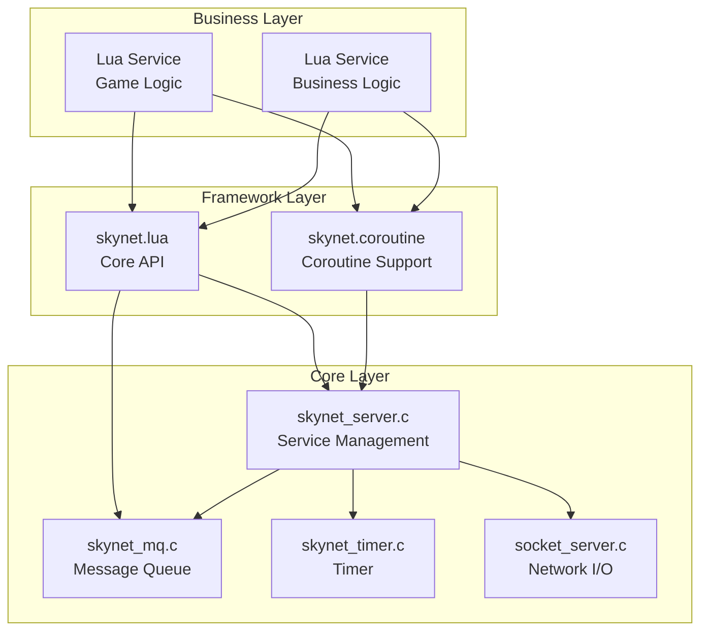
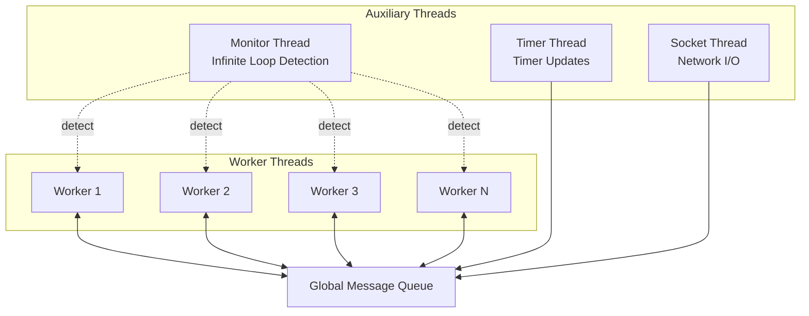
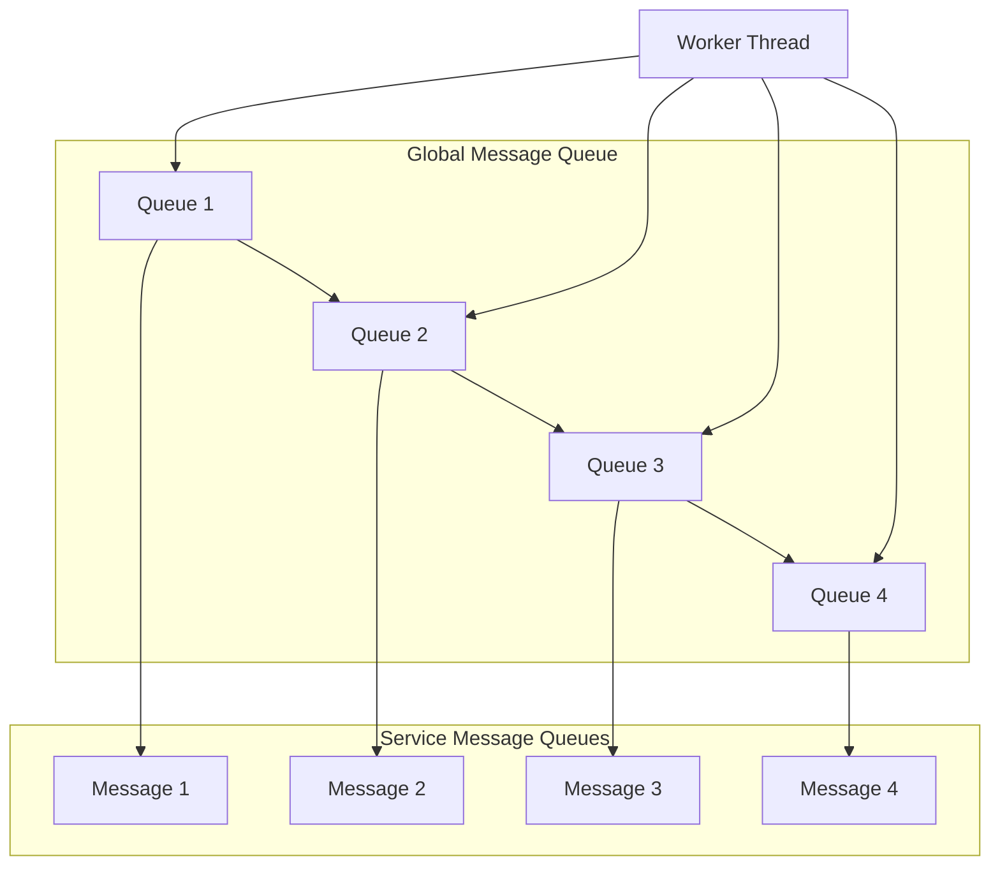
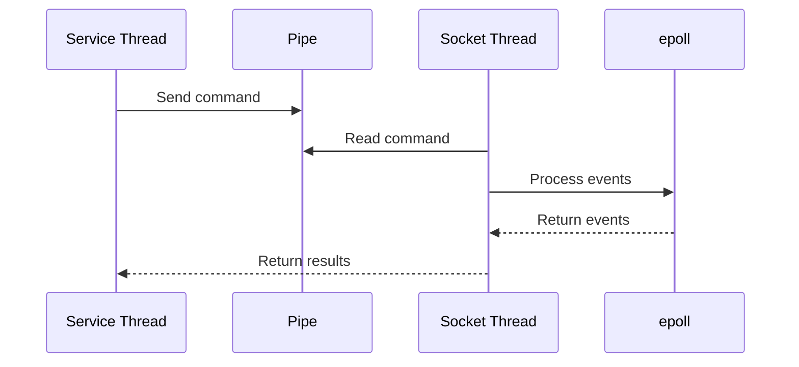
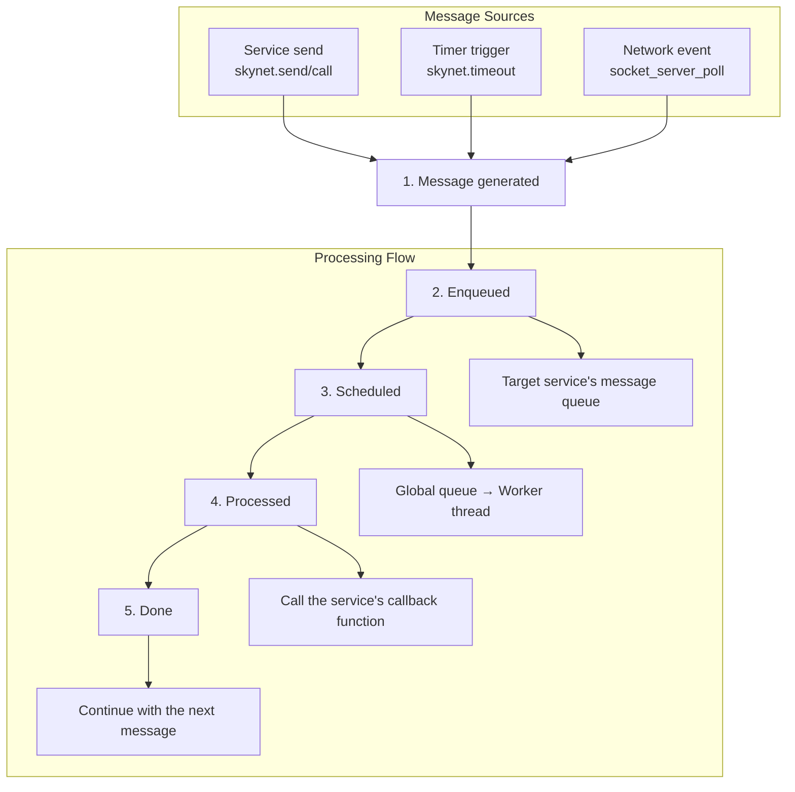
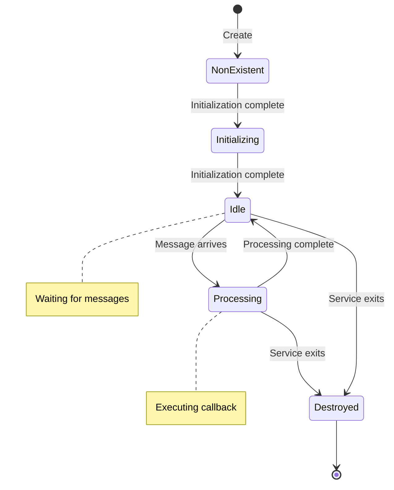

# Architecture Overview

Looking back at Skynet's architectural design, the core philosophy is actually quite simple: **message-driven + Actor model**. This design was not invented out of thin air; it is a natural choice for the game server scenario.

## Design Philosophy

### Message-Driven

In real projects, we found that message-driven design solves several key problems:

1. **Decoupling**: Services interact only through messages, so changing one service does not affect other services
2. **Traceability**: All interactions are recorded as messages, making problems easy to troubleshoot
3. **Async-friendly**: Messages naturally support asynchrony and never block the caller

```lua
-- Send a message, don't wait for a reply
skynet.send(target, "lua", "update", data)

-- Send a message and wait for a reply
local result = skynet.call(target, "lua", "query", key)
```

### Service Isolation

Every service is independent, with its own:
- Message queue
- Execution context
- State data

This design avoids the lock contention problems caused by shared memory. In real projects, we have run into many bugs caused by shared state; Skynet's design fundamentally avoids this class of problems.

### Synchronous Programming Experience

Although the underlying layer is asynchronous, Lua coroutines let you write code in a synchronous style:

```lua
-- Looks synchronous, but is actually asynchronous
local result = skynet.call("service_name", "lua", "query", data)
-- This suspends until a reply arrives
process(result)
```

This design reduces the mental burden of asynchronous programming; developers do not need to write callback functions.

## Core Architecture

### Layered Design

Judging from real project experience, layered design makes code easier to maintain:



**Lessons learned**:

- The business layer uses Lua: high development efficiency, hot updates supported
- The framework layer encapsulates common programming patterns, lowering the development barrier
- The core layer uses C: high performance, good stability

### Thread Model

Skynet's thread model is **multi-threading + message-driven**, not the traditional multi-threaded model:



**Lessons learned**:

- Worker threads: process business messages, count is configurable (usually equal to the number of CPU cores)
- Timer thread: updates timers with 2.5ms precision
- Socket thread: handles network I/O, a dedicated thread avoids blocking business logic
- Monitor thread: detects infinite loops, checks once every 5 seconds

## Core Components

### Message Queue

The message queue is the heart of Skynet; the design is simple yet efficient:



**Design characteristics**:

- One message queue per service, avoiding lock contention
- The global queue handles scheduling, ensuring fairness
- Ring buffer implementation, high memory efficiency

### Service Scheduling

Worker threads take service queues from the global queue and process the messages in them:

```c
// Worker thread main loop
while (!quit) {
    // Take a service queue from the global queue
    q = skynet_context_message_dispatch(sm, q, weight);
    
    if (q == NULL) {
        // No messages, sleep and wait
        pthread_cond_wait(&cond, &mutex);
    }
}
```

**Scheduling policy**:

- Weight mechanism: different threads have different priorities
- Wake-up policy: when messages arrive, wake up at least one thread
- Sleep policy: sleep when there are no messages, saving CPU

### Timer

A timer based on a timing wheel, supporting millisecond precision:

```mermaid
graph TB
    subgraph Timing Wheel
        direction TB
        subgraph Near timers near[256]
            N0[0]
            N1[1]
            N2[2]
            N255[255]
        end
        
        subgraph Remote timers t[4][64]
            L0[Level 0<br/>256-16383]
            L1[Level 1<br/>16384-1048575]
            L2[Level 2<br/>1048576-67108863]
            L3[Level 3<br/>67108864+]
        end
    end
    
    L0 --> N0
    L1 --> L0
    L2 --> L1
    L3 --> L2
```

**Design characteristics**:

- O(1) timer addition
- O(1) time advancement
- Tiered storage, high memory efficiency

### Network I/O

Asynchronous I/O based on epoll/kqueue, handled by a dedicated thread:



**Design characteristics**:

- Dedicated thread, never blocks business logic
- Pipe communication, avoiding lock contention
- Batch event processing, fewer system calls

## Message Lifecycle

A message goes through these stages from generation to being processed:



## Service State Machine

The state transitions of a service over its lifecycle:



## Key Design Decisions

Looking back at Skynet's design, several key decisions are worth reflecting on:

### 1. Why the Actor Model?

Game servers are characterized by:
- Large numbers of independent entities (players, NPCs, monsters)
- Entities that need to interact frequently
- A need for high concurrency

The Actor model fits these needs perfectly: each entity can be an Actor, and message passing avoids the complexity of shared state.

### 2. Why Lua?

- **Lightweight**: the Lua VM has low overhead, so each service can have its own VM
- **Coroutine support**: Lua coroutines make asynchronous programming easy
- **Hot updates**: code can be replaced at runtime
- **Development efficiency**: Lua's concise syntax makes development fast

### 3. Why C for the Core?

- **Performance**: core components such as the message queue and scheduler need ultimate performance
- **Control**: memory, threads, and other resources must be controlled precisely
- **Stability**: core logic rarely changes, implementing it in C is more stable

### 4. Why Does Every Service Have Its Own Message Queue?

- **Isolation**: services never interfere with each other
- **Fair scheduling**: every service gets a fair share of processing time
- **Simpler design**: avoids complicated lock contention

## Comparison with Other Architectures

| Feature | Skynet | Traditional Multithreading | Go | Erlang |
|------|--------|-----------|-----|--------|
| Concurrency model | Actor | Threads | Goroutine | Actor |
| Shared state | None | Yes | Limited | None |
| Memory model | Isolated | Shared | Shared | Isolated |
| Hot update | Supported | Difficult | Difficult | Supported |
| Learning curve | Medium | Low | Low | High |
| Use cases | Game servers | General purpose | General purpose | Telecom |

## Practical Experience

### 1. Service Granularity

In real projects, choosing the right service granularity matters a lot:

- **Too coarse**: a single service carries too much load and is hard to scale
- **Too fine**: message communication overhead grows and complexity increases
- **Just right**: one service is responsible for one independent feature

### 2. Message Design

How well messages are designed directly affects the maintainability of the system:

- **Explicit**: clear message types, explicit parameters
- **Concise**: avoid passing large amounts of data
- **Extensible**: reserve fields for future extension

### 3. Error Handling

Error handling in a message-driven system requires special attention:

- **Message loss**: make sure messages are never lost
- **Timeout handling**: set reasonable timeout values
- **Error propagation**: error information must be delivered correctly

## Next Steps

- [Actor Model](/architecture/actor-model) - Understand the Actor model implementation in depth
- [Message-Driven Design](/architecture/message-driven) - Design details of the message system
- [Services and Modules](/architecture/service-module) - Creating and managing services
