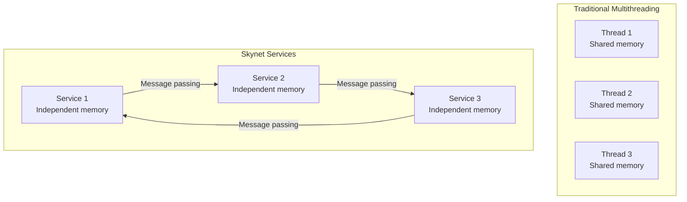
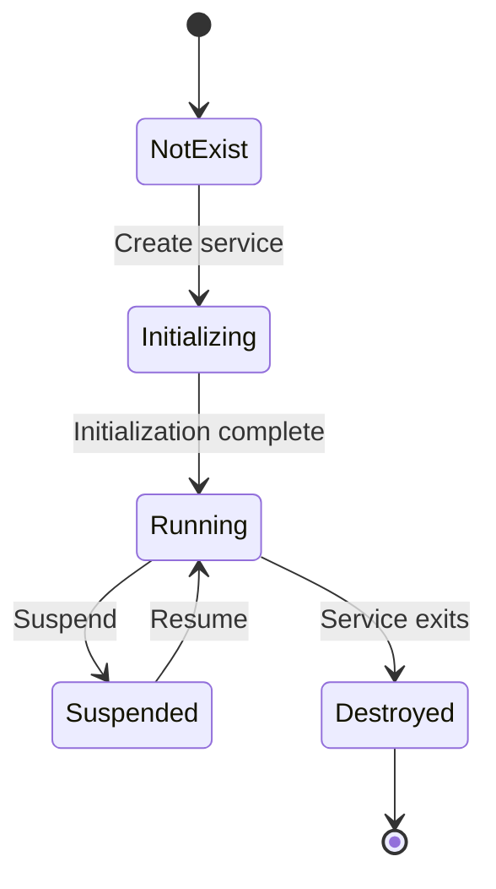

# Services and Modules

Services are a core concept in Skynet, and each service is an independent Actor. In real projects, we have found that understanding how services are created and managed is the key to using Skynet correctly.

## The Concept of Services

### What Is a Service

In Skynet, a **Service** is:
- An independent execution unit with its own lifecycle
- Has its own message queue and interacts with other services through messages
- Can process messages and send messages, implementing business logic
- Defines behavior through callback functions and supports dynamic replacement

### Service vs Thread



## Service Types

### 1. C Services

Services implemented in the C language offer high performance and are suitable for low-level functionality:

```c
// C service interface
struct skynet_module {
    const char *name;
    void *module;
    void *(*init)(const char *args);      // Initialization
    void (*release)(void *inst);          // Release
    void (*signal)(void *inst, int signal); // Signal handling
};
```

**Examples**: logger, harbor, gate, and others

### 2. Lua Services

Services implemented in Lua have high development efficiency and support hot updates:

```lua
-- Lua service template
local skynet = require "skynet"

skynet.start(function()
    -- Initialization code
    
    skynet.dispatch("lua", function(session, address, cmd, ...)
        -- Message handling logic
    end)
end)
```

**Examples**: game logic, business processing, and others

## Service Lifecycle

### State Transitions



### Service Creation

```c
// Service creation in skynet_server.c

struct skynet_context * skynet_context_new(const char *name, const char *param) {
    // 1. Load the module
    struct skynet_module *mod = skynet_module_query(name);
    
    // 2. Create the instance
    void *inst = skynet_module_instance_create(mod, param);
    
    // 3. Create the context
    struct skynet_context *ctx = skynet_malloc(sizeof(*ctx));
    ctx->mod = mod;
    ctx->instance = inst;
    
    // 4. Create the message queue
    ctx->queue = skynet_mq_create(ctx->handle);
    
    // 5. Register the service
    skynet_handle_register(ctx);
    
    return ctx;
}
```

### Service Destruction

```c
// Service destruction in skynet_server.c

void skynet_context_release(struct skynet_context *ctx) {
    // Decrease the reference count
    if (__sync_sub_and_fetch(&ctx->ref, 1) == 0) {
        // Release the instance
        skynet_module_instance_release(ctx->mod, ctx->instance);
        
        // Release the message queue
        skynet_mq_release(ctx->queue);
        
        // Unregister the service
        skynet_handle_retire(ctx->handle);
        
        // Free the memory
        skynet_free(ctx);
    }
}
```

## Service Management

### Service Handles

Every service has a unique handle:

```c
struct handle_storage {
    struct rwlock lock;
    uint32_t harbor;           // Harbor ID
    int slot_size;             // Slot size
    struct skynet_context **slot; // Service array
};
```

### Handle Lookup

```c
// Find a service by handle
struct skynet_context * skynet_handle_grab(uint32_t handle) {
    struct handle_storage *s = H;
    rwlock_rlock(&s->lock);
    
    struct skynet_context *result = NULL;
    int index = handle & (s->slot_size - 1);
    struct skynet_context *ctx = s->slot[index];
    
    if (ctx && ctx->handle == handle) {
        result = ctx;
        skynet_context_grab(result);
    }
    
    rwlock_runlock(&s->lock);
    return result;
}
```

### Name Service

Services can be registered and looked up by name:

```lua
-- Register a service name
skynet.register("player_service")

-- Look up a service by name
local player_service = skynet.localname("player_service")

-- Global name service (cross-node)
skynet.name("player_service", skynet.self())
local player_service = skynet.queryservice("player_service")
```

## Inter-Service Communication

### Direct Communication

```lua
-- Send a message
skynet.send(target_handle, "lua", cmd, ...)

-- Call and wait for the result
local result = skynet.call(target_handle, "lua", cmd, ...)
```

### Communication by Name

```lua
-- Send by name
local target = skynet.localname("service_name")
skynet.send(target, "lua", cmd, ...)

-- Call by name
local target = skynet.localname("service_name")
local result = skynet.call(target, "lua", cmd, ...)
```

### Broadcast Messages

```lua
-- Broadcast to all services
skynet.send_broadcast("lua", "announcement", message)
```

## Service Configuration

### Startup Configuration

```lua
-- config file
skynet.start(function()
    -- Start services
    local logger = skynet.newservice("logger")
    local gate = skynet.newservice("gate", "ws://0.0.0.0:8001")
    local game = skynet.newservice("game")
    
    -- Set up global services
    skynet.name(".logger", logger)
    skynet.name(".gate", gate)
    skynet.name(".game", game)
end)
```

### Service Parameters

```lua
-- Pass parameters when creating a service
local player = skynet.newservice("player", player_id, player_data)

-- The service receives the parameters
local skynet = require "skynet"
local player_id, player_data = ...

skynet.start(function()
    -- Use the parameters for initialization
    init_player(player_id, player_data)
end)
```

## Service Modules

### Module Loading

```c
// Module loading in skynet_module.c

struct skynet_module * skynet_module_query(const char *name) {
    // 1. Look up an already loaded module
    struct skynet_module *mod = find_module(name);
    if (mod) return mod;
    
    // 2. Load a new module
    mod = skynet_malloc(sizeof(*mod));
    mod->name = name;
    mod->module = dlopen(path, RTLD_NOW | RTLD_GLOBAL);
    
    // 3. Get the function pointers
    mod->init = dlsym(mod->module, "skynet_module_create");
    mod->release = dlsym(mod->module, "skynet_module_release");
    mod->signal = dlsym(mod->module, "skynet_module_signal");
    
    return mod;
}
```

### Module Interface

```c
// The interface that a C module must implement

// Create an instance
void * skynet_module_create(const char *args) {
    struct my_module *inst = malloc(sizeof(*inst));
    // Initialize...
    return inst;
}

// Release an instance
void skynet_module_release(void *inst) {
    struct my_module *m = inst;
    // Clean up resources...
    free(m);
}

// Signal handling
void skynet_module_signal(void *inst, int signal) {
    struct my_module *m = inst;
    // Handle the signal...
}
```

## Service Examples

### 1. Logger Service

```lua
-- logger.lua
local skynet = require "skynet"

local log_file

skynet.start(function()
    log_file = io.open("server.log", "a")
    
    skynet.dispatch("lua", function(session, address, ...)
        local msg = table.concat({...}, " ")
        local timestamp = os.date("%Y-%m-%d %H:%M:%S")
        log_file:write(string.format("[%s] %s\n", timestamp, msg))
        log_file:flush()
    end)
end)
```

### 2. Database Service

```lua
-- db_service.lua
local skynet = require "skynet"
local mysql = require "skynet.db.mysql"

local db

skynet.start(function()
    db = mysql.connect({
        host = "127.0.0.1",
        port = 3306,
        database = "game",
        user = "root",
        password = "password"
    })
    
    skynet.dispatch("lua", function(session, address, cmd, ...)
        if cmd == "query" then
            local sql = ...
            local result = db:query(sql)
            skynet.ret(skynet.pack(result))
        elseif cmd == "execute" then
            local sql = ...
            local result = db:execute(sql)
            skynet.ret(skynet.pack(result))
        end
    end)
end)
```

### 3. Player Service

```lua
-- player_service.lua
local skynet = require "skynet"

local players = {}

skynet.start(function()
    skynet.dispatch("lua", function(session, address, cmd, ...)
        if cmd == "login" then
            local player_id, player_data = ...
            players[player_id] = {
                address = address,
                data = player_data
            }
            skynet.ret(skynet.pack(true))
        elseif cmd == "logout" then
            local player_id = ...
            players[player_id] = nil
            skynet.ret(skynet.pack(true))
        elseif cmd == "get_player" then
            local player_id = ...
            skynet.ret(skynet.pack(players[player_id]))
        end
    end)
end)
```

## Inter-Service Cooperation

### Request-Response Pattern

```lua
-- Service A
local result = skynet.call(service_b, "lua", "process", data)

-- Service B
skynet.dispatch("lua", function(session, address, cmd, data)
    if cmd == "process" then
        local result = heavy_processing(data)
        skynet.ret(skynet.pack(result))
    end
end)
```

### Pipeline Pattern

```lua
-- Service A → Service B → Service C
local step1 = skynet.call(service_a, "lua", "step1", data)
local step2 = skynet.call(service_b, "lua", "step2", step1)
local step3 = skynet.call(service_c, "lua", "step3", step2)
```

### Parallel Processing

```lua
-- Call multiple services in parallel
local co1 = skynet.fcall(service_a, "lua", "task1")
local co2 = skynet.fcall(service_b, "lua", "task2")
local co3 = skynet.fcall(service_c, "lua", "task3")

-- Wait for all results
local result1 = skynet.wait(co1)
local result2 = skynet.wait(co2)
local result3 = skynet.wait(co3)
```

## Best Practices

### 1. Service Granularity

```lua
-- Good: services with a single responsibility
local player_service = {}      -- Only handles player logic
local inventory_service = {}   -- Only handles inventory logic
local quest_service = {}       -- Only handles quest logic

-- Bad: services with mixed responsibilities
local god_service = {}         -- Handles all logic
```

### 2. Error Handling

```lua
-- Services should handle errors instead of crashing
skynet.dispatch("lua", function(session, address, cmd, ...)
    local ok, result = pcall(function()
        return handle_command(cmd, ...)
    end)
    
    if ok then
        skynet.ret(skynet.pack(result))
    else
        skynet.ret(skynet.pack(nil, result))
        log("Error in service: " .. tostring(result))
    end
end)
```

### 3. Resource Management

```lua
-- Clean up resources when the service exits
skynet.start(function()
    -- Initialize resources
    local resource = acquire_resource()
    
    skynet.dispatch("lua", function(session, address, cmd, ...)
        -- Use the resource
    end)
    
    -- Register an exit cleanup
    skynet.atexit(function()
        release_resource(resource)
    end)
end)
```

## Next Steps

- [Message Queue Implementation](/architecture/message-queue) - A deep dive into the implementation of the message queue
- [Service Scheduling](/architecture/service-scheduling) - Understand how services are scheduled
- [skynet_server.c Analysis](/analysis/skynet-server) - Source code analysis of service management
