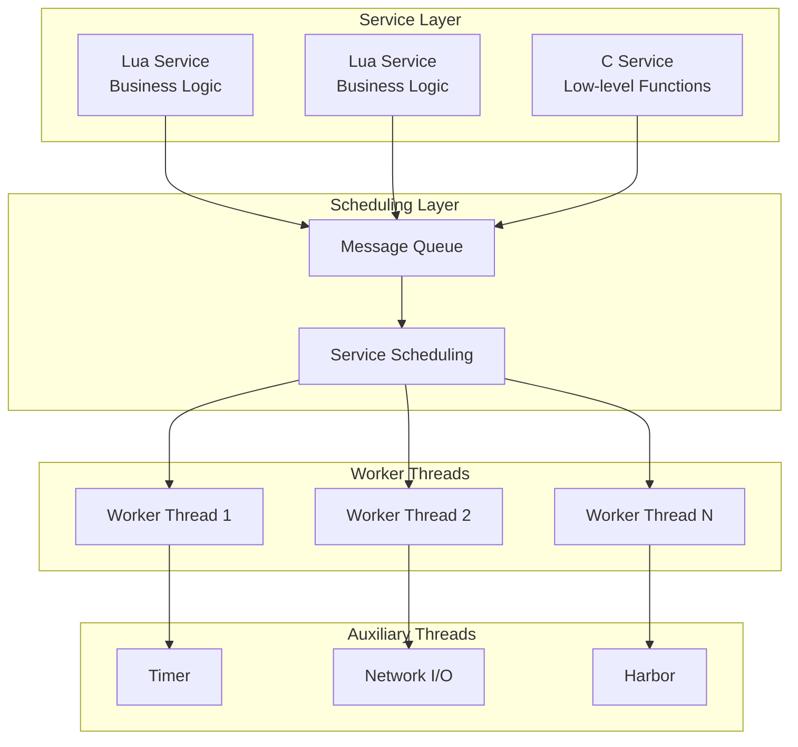

# Overview

Skynet is a framework commonly used by our team in game server development. After practicing across multiple projects, we believe its design philosophy is worth learning from and referencing.

## What is Skynet

Skynet is a lightweight game server framework developed by cloudwu, with widespread application in the domestic gaming industry. From a practical usage perspective, its core design can be summarized as the **Actor model** + **message-driven**.

### Core Features

In actual projects, we found these features particularly valuable:

- **Actor Model**: Each service is an independent Actor, communicating through message passing, avoiding the complexity of shared state
- **Message-Driven**: All logic is completed within message handling, making system behavior traceable
- **Lightweight**: A C core + Lua scripting layered architecture, balancing performance and development efficiency
- **High Performance**: Asynchronous I/O based on epoll/kqueue, capable of handling a large number of connections on a single machine
- **Hot Update**: Lua services support live updates without downtime, making online issue fixes more flexible
- **Cluster Support**: Distributed deployment through the Harbor mechanism, supporting horizontal scaling

## Architecture Overview



## Core Components

### Message Queue (skynet_mq.c)
Each service has an independent message queue. Services communicate by sending messages to each other's message queues. The global message queue is responsible for scheduling the message queues of all services.

### Service Scheduling (skynet_server.c)
Multiple worker threads fetch service queues from the global queue and process the messages within them. The scheduler ensures messages are fairly distributed to the various worker threads.

### Timer (skynet_timer.c)
A timer implementation based on the time wheel, supporting millisecond-level scheduled tasks. Used for timeout handling, heartbeat detection, and similar scenarios.

### Network I/O (socket_server.c)
A unified socket abstraction supporting TCP/UDP. After asynchronous operations complete, services are notified through messages, allowing services to write asynchronous logic in a synchronous manner.

### Lua Virtual Machine (lua-skynet.c)
Each Lua service has an independent Lua virtual machine, ensuring isolation between services. It supports hot updates, allowing Lua code to be replaced at runtime.

### Harbor Cluster (skynet_harbor.c)
A cross-node service invocation mechanism supporting distributed deployment. Service registration and discovery are implemented through a name service.

## Quick Start

### Build Skynet

```bash
git clone https://github.com/cuihairu/skynet.git
cd skynet
make linux  # or macosx, freebsd
```

### Run Examples

```bash
# Start skynet node
./skynet examples/config

# Run client in another terminal
./3rd/lua/lua examples/client.lua
```

## Documentation Structure

- **Quick Start**: Helps you get started with Skynet quickly
- **Architecture Analysis**: Deeply understand Skynet's design principles
- **Source Code Analysis**: Analyze the core implementation module by module

## Who Should Read This

- Game server developers
- Developers interested in the Actor model
- Developers who want to learn high-performance network programming
- Architects hoping to understand game server architecture
